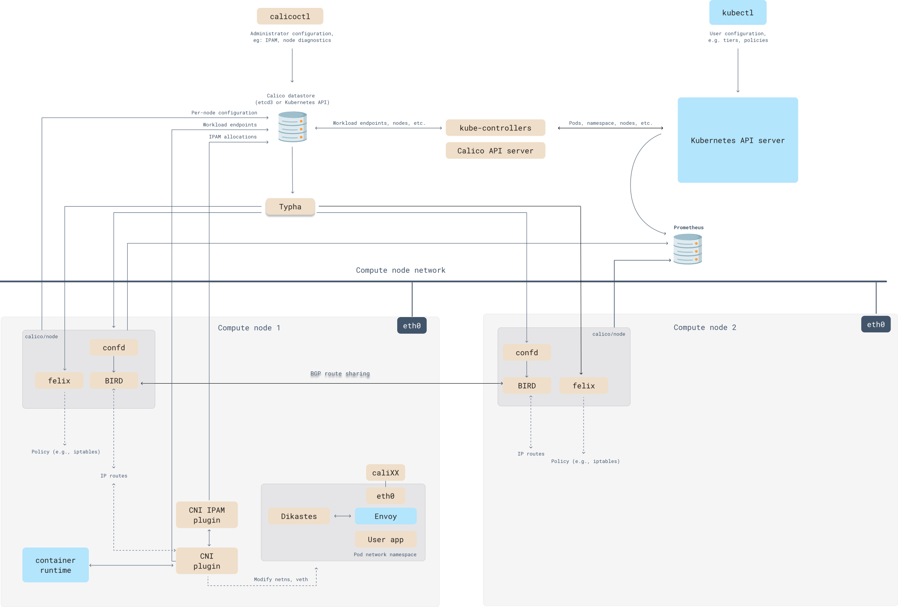

在 Calico（或基于 BGP 的网络架构）中，路由宣告的触发条件与网络拓扑变化、策略调整或系统事件密切相关。以下是详细场景分析及触发机制：

---

## **1. Calico架构图**



---


| **组件**               | **子模块/文件**          | **核心功能**                                                                 | **配置参数示例**                                                                 | **交互组件**                     | **典型工作场景**                                                                 |
|------------------------|--------------------------|-----------------------------------------------------------------------------|---------------------------------------------------------------------------------|----------------------------------|---------------------------------------------------------------------------------|
| **Felix**              | `felix.cfg`              | - 管理节点本地路由表 (`route table`) <br>- 配置iptables/eBPF规则链 (`cali-INPUT`, `cali-FORWARD`等) <br>- 实施网络策略（标记流量`allow/deny`） | `RouteRefreshInterval=10s` <br>`MetadataAddr=127.0.0.1` <br>`IptablesMarkMask=0xff000000` | BIRD, etcd/K8s API, Typha        | Pod创建时自动添加路由规则；策略更新时实时生效                                      |
| **BIRD**               | `bird.cfg` (由confd生成) | - 通过BGP协议广播本节点Pod CIDR（如`10.0.1.0/24`）<br>- 学习其他节点的路由（`via Node2`）                  | `protocol bgp { local as 64512; neighbor 192.168.1.2 as 64512; }`              | Felix, Route Reflector           | 新节点加入时自动建立BGP对等连接                                                  |
| **Calico CNI Plugin**  | `10-calico.conflist`     | - 调用IPAM插件分配Pod IP<br>- 创建veth pair (`caliXXXXX`)<br>- 设置Pod网络命名空间路由                   | `"ipam": { "type": "calico-ipam", "subnet": "usePodCidr" }`                    | kubelet, IPAM, Felix             | `kubectl run`时被kubelet调用，完成Pod网络配置                                     |
| **calico-kube-controllers** | `policy-controller`      | - 监听K8s `NetworkPolicy`并同步到Felix<br>- 清理孤儿IP地址（`IPGC`）<br>- 维护节点心跳                    | `controllers: node, policy, serviceaccount`                                     | K8s API Server, etcd             | 用户创建`NetworkPolicy`时，转换为Calico格式并下发                                 |
| **Typha**              | `typha-deployment.yaml`  | - 代理Felix的API请求（缓存`Nodes`, `Policies`）<br>- 减少API Server负载（连接数从O(N)→O(1)）             | `maxConnsPerClient=4` <br>`clientPort=5473`                                    | Felix, K8s API                   | 集群超过50节点时，Felix通过Typha获取策略而非直连API                                |
| **Route Reflector**    | `bgpconfiguration.yaml`  | - 集中式路由分发（替代全互联）<br>- 支持集群AS号（`AS 64512`）和路由聚合                                   | `routeReflectorClusterID: 1.0.0.1` <br>`logSeverityScreen: Info`               | BIRD (所有节点)                  | 跨可用区部署时，通过RR避免节点间直接BGP连接                                       |
| **etcd/K8s API**       | `calico-config` ConfigMap | - 存储`IPPools`（`10.0.0.0/16`）<br>- 保存`BGPPeers`和`NetworkPolicy`定义                               | `etcd_endpoints: "https://etcd:2379"` <br>`useKubernetesAPI: true`            | 所有组件                          | 管理员通过`calicoctl`创建IP池时写入etcd                                           |
| **confd**              | `/etc/calico/confd`      | - 监听etcd/K8s API变更（如`BGPPeer`更新）<br>- 动态生成BIRD配置并触发重载                                  | `confd -watch -interval 10`                                                    | BIRD, etcd                       | BGP对等节点IP变更时，自动更新`bird.cfg`并执行`birdc configure`                   |
| **eBPF Dataplane**     | `bpfnat`, `bpfilter`    | - 替换kube-proxy实现Service负载均衡<br>- 通过eBPF map加速策略匹配（`calico_prefilter`）                  | `bpfEnabled: true` <br>`bpfExternalServiceMode: DSR`                           | Linux内核, Felix                 | 高性能场景下，Service的DNAT规则由eBPF程序处理                                     |
| **WireGuard**          | `wg-cali` (接口)        | - 加密节点间流量（`udp port 51820`）<br>- 支持PSK或证书认证                                              | `wireguardEnabled: true` <br>`wireguardListeningPort: 51820`                   | 节点网络栈                        | 跨公有云部署时，自动建立加密隧道                                                  |


## **2. Calico使用**

### 1.setup kind集群
```bash
kind: Cluster
apiVersion: kind.x-k8s.io/v1alpha4
nodes:
  - role: control-plane
  - role: worker
  - role: worker
networking:
  disableDefaultCNI: true
  podSubnet: 192.168.0.0/16
```

```bash
kind create cluster --name=calico-cluster --config=config.yaml
```

### 2. 安装calico
```bash
kubectl create -f https://raw.githubusercontent.com/projectcalico/calico/v3.30.2/manifests/tigera-operator.yaml
```
```bash
kubectl create -f https://raw.githubusercontent.com/projectcalico/calico/v3.30.2/manifests/custom-resources.yaml
```

### 3. 查看web页面
```bash
kubectl port-forward -n calico-system service/whisker 8081:8081
```

### 4. 安装nginx测试

```bash
kubectl create namespace quickstart
```
```bash
kubectl create deployment --namespace=quickstart nginx --image=nginx
```
```bash
kubectl expose --namespace=quickstart deployment nginx --port=80
```
安装并暴露服务成功之后，创建busybox容器并对nginx pod进行访问
```bash
kubectl run --namespace=quickstart access --rm -ti --image busybox /bin/sh
```
此时，通过pod网络访问集群内nginx和访问外网都能成功
```bash
wget -qO- http://nginx
wget -qO- https://docs.tigera.io/pod-connection-test.txt
```

### 5. 通过calico对网络加一些限制
对进ingress和egress都进行限制
```bash
kubectl create -f - <<EOF
apiVersion: projectcalico.org/v3
kind: GlobalNetworkPolicy
metadata:
  name: default-deny
spec:
  selector: projectcalico.org/namespace not in {'kube-system', 'calico-system', 'calico-apiserver'}
  types:
    - Ingress
    - Egress
EOF
```
在进行网络限制之后，访问nginx和外网都会失败。
```bash
wget -qO- http://nginx
wget -qO- https://docs.tigera.io/pod-connection-test.txt
```

### 5. 把网络放开一点
把egress放开
```bash
kubectl create -f - <<EOF
apiVersion: projectcalico.org/v3
kind: NetworkPolicy
metadata:
  name: allow-busybox-egress
  namespace: quickstart
spec:
  selector: run == 'access'
  types:
  - Egress
  egress:
  - action: Allow
EOF
```
此时访问外网可以成功，但是访问nginx依旧失败。
```bash
wget -qO- https://docs.tigera.io/pod-connection-test.txt
wget -qO- http://nginx
```
把nginx的ingress打开
```bash
kubectl create -f - <<EOF
apiVersion: projectcalico.org/v3
kind: NetworkPolicy
metadata:
  name: allow-nginx-ingress
  namespace: quickstart
spec:
  selector: app == 'nginx'
  types:
  - Ingress
  ingress:
  - action: Allow
    source:
      selector: run == 'access'
EOF
```
此时访问nginx即可成功
```bash
wget -qO- http://nginx
```

### 6. 清理
```bash
kind delete cluster --name calico-cluster
```
