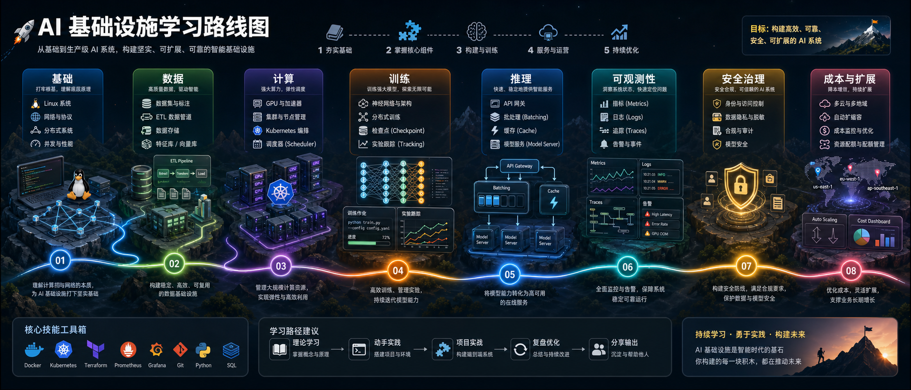

AI 基础设施相关笔记，目前围绕 GPU 资源管理、设备分配和虚拟化实现展开。

- [DRA 与 Device Plugin](/notes/ai-infra/dra-device-plugin/)
- [HAMi](/notes/ai-infra/hami/)
- [HAMi 设备注入与库劫持](/notes/ai-infra/hjzbo16q/)

大部分笔记由 AI 辅助生成，主要用于整理思路、沉淀资料和后续检索，内容可能存在疏漏，使用前建议结合官方文档或实际环境再核对一遍。
