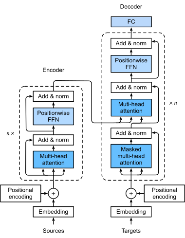
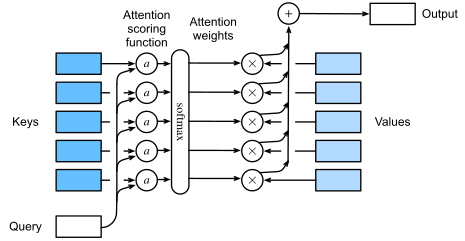
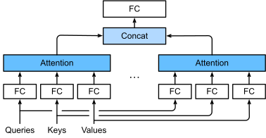

# Transformer 的数学原理与完整推导

Transformer 把 token 序列变成向量，通过注意力交换不同位置的信息，再把每个位置的向量映射成预测分数。对自回归语言模型来说，最后一个位置的分数用于选择下一个 token；把它追加到输入后，就可以继续生成。

先看原始 Transformer 的整体架构：左侧 encoder 处理源序列，右侧 decoder 结合源序列和已有的目标序列，预测下一个 token。



<div class="llm-figure-caption">

图 1：原始 Transformer 的 encoder-decoder 架构，从下向上阅读。图中的 $n\times$ 表示该组模块重复堆叠的层数，与本文用 $n$ 表示的序列长度含义不同。图源：[《动手学深度学习》图 11.7.1](https://d2l.ai/chapter_attention-mechanisms-and-transformers/transformer.html)，作者团队原图，按 [CC BY-SA 4.0](https://creativecommons.org/licenses/by-sa/4.0/) 使用。

</div>

沿箭头从下往上读：底部把 token 变成向量并加入位置信息，中间反复经过注意力、前馈网络、残差连接与归一化，顶部 FC 将最终特征映射成词表分数，再通过 softmax 得到预测概率；图中省略了最后的 softmax。

后面的数值例子采用 **单层、decoder-only、Post-LN Transformer**，保留右侧的因果自注意力、FFN 及其残差和归一化，省去左侧 encoder 和连接两侧的 cross-attention。本例用手动指定的权重演示计算流程。

下面按“输入 → 注意力 → 完整 block → 词表概率”的顺序展开，再分别说明训练如何更新参数、推理如何逐个生成 token。

| 部分 | 要回答的问题 | 参数是否变化 |
| --- | --- | --- |
| 共同前向 | 给定输入和参数，怎样算出各位置的预测概率？ | 本次计算中固定 |
| 训练 | 怎样用正确答案修正参数？ | 优化器更新参数 |
| 推理 | 怎样用已有参数连续生成 token？ | 参数固定，输入逐轮增长 |

## 1. 共同部分：一次前向计算

### 1.1 模型到底在计算什么

设输入 token 为 $x_1,\ldots,x_n$。模型计算：

$$
p_\theta(x_{n+1}\mid x_1,\ldots,x_n)
$$

其中 $\theta$ 表示模型参数。输出是整个词表上的概率分布，随后才由解码策略选择一个 token。

例如输入 `我 爱`，词表只有 `我、爱、你、<eos>、学习` 五项，那么模型需要输出五个概率，且它们相加为 1。这里手动指定 token 和词表，真实分词器的划分方式可能不同。

序列表示矩阵按行存放各位置的向量，以下省略 batch 维度。参数表另有自己的索引方式，例如 embedding 表的行对应词表项。主算例的符号约定如下：

| 符号 | 含义 | 本文例子的取值或形状 |
| --- | --- | --- |
| $n$ | 输入序列长度 | $2$ |
| $m$ | 词表大小 | $5$ |
| $d$ | 模型隐藏维度，即 $d_{\text{model}}$ | $4$ |
| $h$ | 注意力头数 | $2$ |
| $d_k,d_v$ | 每个头的 Q/K、V 维度 | 均为 $2$ |
| $d_{\text{ff}}$ | 前馈网络的中间维度 | $3$ |
| $E$ | embedding 参数表：每行存一个词表项的向量 | $m\times d$ |
| $X$ | 当前层的输入：每行是一个位置的表示 | $n\times d$ |
| $Q_a,K_a,V_a$ | 第 $a$ 个头由输入投影得到的查询、键和值 | $n\times2$ |
| $A_a$ | 第 $a$ 个头的注意力权重：每行决定从各来源位置取多少 | $n\times n$ |
| $O_a$ | 第 $a$ 个头的输出：每行是按权重汇总后的内容向量 | $n\times2$ |
| $O$ | 多头拼接并投影后的注意力子层输出 | $n\times d$ |
| $H$ | Transformer block 的输出；最后一层的 $H$ 交给词表输出层 | $n\times d$ |
| $L$ | logits：每行给出一个位置对各词表候选的预测分数 | $n\times m$ |
| $P_{\text{vocab}}$ | 词表概率：将 $L$ 每行归一化得到的预测分布 | $n\times m$ |

真实模型通常让 $d_{\text{ff}}>d$。这里取 3，只是为了缩短手算矩阵。所有小数展示到六位，后续计算使用未舍入的值。

### 1.2 从 token 到输入矩阵

#### 1.2.1 Embedding 是一次查表

规定 token ID 为：`我=0、爱=1、你=2、<eos>=3、学习=4`。每个词表项用四维向量表示，指定 $5\times4$ 的 embedding 表：

$$
E=
\begin{bmatrix}
1&0&0&0\\
0&1&1&0\\
0&0&1&1\\
1&-1&0&0\\
0&0&0&1
\end{bmatrix}
$$

输入 `我 爱` 查出第 0、1 行，得到 $X_{\text{token}}$。它按句子中的位置排列向量，每行对应一个输入 token，每列对应一个特征分量：

$$
X_{\text{token}}=
\begin{bmatrix}
1&0&0&0\\
0&1&1&0
\end{bmatrix}
$$

实际实现就是根据 token ID，从 embedding 表中取出对应的行。

这些向量的坐标没有预先规定的语言学含义。训练会调整 $E$，让它和后续各层共同完成预测。

#### 1.2.2 加入位置信息

仅看 token embedding，两个相同 token 会有相同的初始向量。位置编码为每个位置提供一个向量，让模型能够利用顺序信息。位置编码矩阵 $P$ 与输入形状相同，本例为 $2\times4$。

本例的四维正弦位置向量为 $P_p=[\sin p,\cos p,\sin(p/100),\cos(p/100)]$，位置编号 $p$ 从 0 开始；后面生成新 token 时也使用这条规则。前两个位置组成：

$$
P=\begin{bmatrix}
0&1&0&1\\
\sin1&\cos1&\sin0.01&\cos0.01
\end{bmatrix}
$$

本例约定 $X=X_{\text{token}}+P$，得到：

$$
X\approx
\begin{bmatrix}
1&1&0&1\\
0.841471&1.540302&1.010000&0.999950
\end{bmatrix}
$$

原始 Transformer 会先把 token embedding 乘以 $\sqrt d$ 再加位置编码；本例明确省去这一步缩放。正弦位置编码也只是位置表示的一种选择。[原论文 §3.4–3.5](https://arxiv.org/html/1706.03762v7#S3.SS4)

### 1.3 从点积推导注意力

每个 token 用多少个数表示，由模型的隐藏维度 $d$ 决定；序列包含多少个 token，则由长度 $n$ 决定。这是两个独立的量：

$$
X\in\mathbb R^{n\times d},\qquad XX^\top\in\mathbb R^{n\times n}
$$

例如，五个 token、每个向量 4096 维时，$X$ 的形状是 $5\times4096$，匹配矩阵仍是 $5\times5$。每个匹配分数由两条 4096 维向量的点积得到。

下面从两个向量的点积开始，用一个独立的“五个 token、每个向量四维”示例逐步构造注意力。本节只看一个头，并令它的 Q、K、V 都为四维，便于观察向量如何比较和汇总；第 1.4 节再回到前面定义的双头模型，进行完整前向计算。

#### 1.3.1 计算两个向量的点积

设两个四维向量为 $a=[1,2,0,1]$、$b=[2,1,1,0]$。点积就是对应分量相乘，再把四项结果相加：

$$
a b^\top=1\times2+2\times1+0\times1+1\times0=4
$$

固定 $a=[1,2,0,1]$，换几个同样为四维的向量来比较：

| 另一个向量 | 逐项计算 | 点积 | 与 $a$ 的方向关系 |
| --- | --- | --- | --- |
| $[1,2,0,1]$ | $1\times1+2\times2+0\times0+1\times1$ | $6$ | 方向相同 |
| $[2,1,1,0]$ | $1\times2+2\times1+0\times1+1\times0$ | $4$ | 方向比较接近 |
| $[-1,0,2,1]$ | $1\times(-1)+2\times0+0\times2+1\times1$ | $0$ | 互相垂直 |
| $[-1,-2,0,-1]$ | $1\times(-1)+2\times(-2)+0\times0+1\times(-1)$ | $-6$ | 方向相反 |

这里各向量的长度都是 $\sqrt6$，所以点积大小反映了方向的接近程度。对于一般的非零向量：

$$
a b^\top=\sum_{r=1}^{d}a_rb_r
=\lVert a\rVert\lVert b\rVert\cos\theta
$$

向量长度也会参与计算。例如把 $b$ 放大两倍，点积也会放大两倍。无论向量有 4 维还是 4096 维，点积都按同样的规则计算，最终得到一个匹配分数。

#### 1.3.2 把所有位置的点积排成矩阵

假设输入被分成 `我 / 今天 / 在 / 家 / 学习` 五个 token。为方便演算，给这五个位置指定如下四维向量：

| 位置 | token | 向量 |
| --- | --- | --- |
| 1 | 我 | $x_1=[1,0,1,0]$ |
| 2 | 今天 | $x_2=[0,1,0,1]$ |
| 3 | 在 | $x_3=[1,1,0,0]$ |
| 4 | 家 | $x_4=[0,1,1,0]$ |
| 5 | 学习 | $x_5=[1,0,0,1]$ |

这些是用于演示运算的手选数值。下面用 $x_i$ 表示输入矩阵 $X$ 的第 $i$ 行，即第 $i$ 个位置的向量。把五个向量按行放进矩阵，得到：

$$
X=\begin{bmatrix}
1&0&1&0\\
0&1&0&1\\
1&1&0&0\\
0&1&1&0\\
1&0&0&1
\end{bmatrix}_{5\times4}
$$

让每个位置分别与五个位置比较，一共计算 $5\times5=25$ 个点积。每次点积都累加四对分量的乘积。例如第四个位置“家”与所有位置的比较为：

$$
\begin{aligned}
x_4x_1^\top&=0\times1+1\times0+1\times1+0\times0=1\\
x_4x_2^\top&=0\times0+1\times1+1\times0+0\times1=1\\
x_4x_3^\top&=0\times1+1\times1+1\times0+0\times0=1\\
x_4x_4^\top&=0\times0+1\times1+1\times1+0\times0=2\\
x_4x_5^\top&=0\times1+1\times0+1\times0+0\times1=0
\end{aligned}
$$

这五个分数组成矩阵的第四行。对其余位置做同样的计算，就得到完整的匹配矩阵：

$$
S_0=XX^\top=\begin{bmatrix}
2&0&1&1&1\\
0&2&1&1&1\\
1&1&2&1&1\\
1&1&1&2&0\\
1&1&1&0&2
\end{bmatrix}_{5\times5}
$$

这里的形状变化是：

$$
\underbrace{X}_{5\times4}\;\underbrace{X^\top}_{4\times5}
=\underbrace{S_0}_{5\times5}
$$

矩阵的第 $i$ 行表示“位置 $i$ 与所有位置的匹配分数”。例如第四行 $[1,1,1,2,0]$，依次记录第四个位置与五个位置的比较结果。矩阵的行列都按 `我、今天、在、家、学习` 的顺序排列。

#### 1.3.3 把分数变成权重，再汇总向量

接下来，把分数矩阵变成权重矩阵，再用这些权重汇总输入向量。为便于观察加权求和，这里先直接使用点积分数；在完整公式中再加入标准的缩放因子。

读分数矩阵时，**行表示哪个位置在读取信息，列表示信息来自哪个位置**。自回归模型中，每个位置可以读取自己和此前的位置：第一行能读 1 个位置，第三行能读 3 个位置，第五行能读全部 5 个位置。

用因果 mask 矩阵 $M$ 指定可见范围：允许读取的位置为 0，未来位置为 $-\infty$。将它加到分数上，就能屏蔽未来位置：

$$
M=\begin{bmatrix}
0&-\infty&-\infty&-\infty&-\infty\\
0&0&-\infty&-\infty&-\infty\\
0&0&0&-\infty&-\infty\\
0&0&0&0&-\infty\\
0&0&0&0&0
\end{bmatrix}
$$

加上 mask 后，分数矩阵变为：

$$
\widetilde S=S_0+M=\begin{bmatrix}
2&-\infty&-\infty&-\infty&-\infty\\
0&2&-\infty&-\infty&-\infty\\
1&1&2&-\infty&-\infty\\
1&1&1&2&-\infty\\
1&1&1&0&2
\end{bmatrix}
$$

然后对这个矩阵的**每一行分别做 softmax**。对第 $i$ 行，先将各项取指数，再除以这一行指数值的总和：

$$
A_{ij}=\frac{e^{\widetilde S_{ij}}}{\sum_{k=1}^{5}e^{\widetilde S_{ik}}}
$$

由于 $e^{-\infty}=0$，未来位置的权重为 0。第一行因此得到 $[1,0,0,0,0]$。

沿用第四个位置“家”。加上 mask 后，第四行是 $[1,1,1,2,-\infty]$，它可以读取前三个位置和自己。softmax 的分母为：

$$
D_4=e^1+e^1+e^1+e^2+0\approx15.543902
$$

所以第四行的五个权重为：

$$
[A_{41},A_{42},A_{43},A_{44},A_{45}]
=\frac{1}{D_4}[e^1,e^1,e^1,e^2,0]
\approx[0.174878,0.174878,0.174878,0.475367,0]
$$

对五行分别计算，得到完整的注意力权重矩阵：

$$
A=\operatorname{softmax}_{\text{row}}(\widetilde S)
\approx\begin{bmatrix}
1&0&0&0&0\\
0.119203&0.880797&0&0&0\\
0.211942&0.211942&0.576117&0&0\\
0.174878&0.174878&0.174878&0.475367&0\\
0.164307&0.164307&0.164307&0.060445&0.446633
\end{bmatrix}
$$

每一行权重之和都为 1，展示值的末位可能有舍入误差。第四行表示“家”从前三个位置各取约 17.5%，从自己取约 47.5%，从未来位置“学习”取 0。各行的归一化分别进行。

接下来要做的事情是：**先让每个词的整条向量乘上它的权重，再把五条向量相加。**

直接用刚才算出的第四行权重，看看“家”如何汇总信息。每个权重都作用于对应词的整条向量。例如“今天”的权重约为 0.174878，就把它的四个分量都乘以这个权重；“学习”的权重为 0，因此整条向量乘完后都变成 0。

下表和后续计算中的小数保留六位，汇总结果使用未舍入的权重计算：

| 词 | 原来的向量 | 权重 | 整条向量乘以权重 |
| --- | --- | --- | --- |
| 我 | `[1, 0, 1, 0]` | $A_{41}\approx0.174878$ | `[0.174878, 0, 0.174878, 0]` |
| 今天 | `[0, 1, 0, 1]` | $A_{42}\approx0.174878$ | `[0, 0.174878, 0, 0.174878]` |
| 在 | `[1, 1, 0, 0]` | $A_{43}\approx0.174878$ | `[0.174878, 0.174878, 0, 0]` |
| 家 | `[0, 1, 1, 0]` | $A_{44}\approx0.475367$ | `[0, 0.475367, 0.475367, 0]` |
| 学习 | `[1, 0, 0, 1]` | $A_{45}=0$ | `[0, 0, 0, 0]` |

接着把最右边的五条向量相加。向量相加，就是第一分量与第一分量相加，第二分量与第二分量相加，依此类推：

```text
  [0.174878, 0.000000, 0.174878, 0.000000]
+ [0.000000, 0.174878, 0.000000, 0.174878]
+ [0.174878, 0.174878, 0.000000, 0.000000]
+ [0.000000, 0.475367, 0.475367, 0.000000]
+ [0.000000, 0.000000, 0.000000, 0.000000]
------------------------------------------
≈ [0.349755, 0.825122, 0.650245, 0.174878]
```

这样就得到了第四个位置汇总后的向量 $o_4$：

$$
\begin{aligned}
o_4&=A_{41}x_1+A_{42}x_2+A_{43}x_3+A_{44}x_4+0x_5\\
&\approx[0.349755,0.825122,0.650245,0.174878]
\end{aligned}
$$

现在只看结果里的第一个数 0.349755。它来自五条原始向量的第一个分量，分别乘以各自的权重，再相加：

$$
\begin{aligned}
O_{4,1}
&=A_{41}\times1+A_{42}\times0+A_{43}\times1+A_{44}\times0+0\times1\\
&=A_{41}+A_{43}=\frac{2e^1}{D_4}\approx0.349755
\end{aligned}
$$

这里用到的五个数 $1,0,1,0,1$，恰好就是 $X$ 的第一列。因此同一笔计算也可以写成“权重行乘以 $X$ 的第一列”：

$$
O_{4,1}=
[A_{41},A_{42},A_{43},A_{44},0]
\begin{bmatrix}1\\0\\1\\0\\1\end{bmatrix}
\approx0.349755
$$

用同一行权重乘以 $X$ 的第二列，就得到第二个分量，约为 0.825122；乘以第三列、第四列，分别得到约 0.650245 和 0.174878。把这四个结果排在一起，仍然是刚才的 $o_4\approx[0.349755,0.825122,0.650245,0.174878]$。

**“行乘列”就是把整条向量的加权求和，拆成一个分量一个分量地计算。** $X$ 的一行保存一个词的完整向量，一列则收集五个词在同一个坐标上的值。取第一列，是为了算出新向量的第一分量；取第二列，是为了算出第二分量。词向量的坐标由模型学习形成，单个坐标未必有容易命名的语义；计算时，按照共同的坐标顺序对齐即可。

其他位置也用各自的一行权重做同样的事。把五个新向量依次排成矩阵，就是 $O=AX$。其中第 $i$ 个新向量的第 $r$ 个分量为：

$$
O_{ir}=\sum_{j=1}^{5}A_{ij}X_{jr}
$$

这里，$i$ 选定要更新哪个位置，$r$ 选定新向量的哪个分量，$j$ 则遍历提供信息的五个位置。

对五个位置都完成汇总后，完整输出为：

$$
O\approx\begin{bmatrix}
1&0&1&0\\
0.119203&0.880797&0.119203&0.880797\\
0.788058&0.788058&0.211942&0.211942\\
0.349755&0.825122&0.650245&0.174878\\
0.775248&0.389060&0.224752&0.610940
\end{bmatrix}_{5\times4}
$$

第四个位置“家”原来的向量是 $[0,1,1,0]$，现在变成了包含前三个位置和自身信息的 $[0.349755,0.825122,0.650245,0.174878]$。第五个位置“学习”受因果 mask 限制，没有参与这次汇总。整个过程的形状变化是：

$$
\underbrace{A}_{5\times5}\;\underbrace{X}_{5\times4}
=\underbrace{O}_{5\times4}
$$

| 矩阵 | 每一行表示什么 | 每一列表示什么 | 本例形状 |
| --- | --- | --- | --- |
| $A$ | 一个位置分配的注意力权重 | 一个信息来源位置 | $5\times5$ |
| $X$ | 一个位置的输入向量 | 一个特征维度 | $5\times4$ |
| $O=AX$ | 一个位置汇总后的新向量 | 一个特征维度 | $5\times4$ |

$A_{ij}$ 回答“位置 $i$ 从位置 $j$ 取多少”，$O$ 的第 $i$ 行保存实际汇总得到的向量。推广到 $n$ 个位置、每个向量 $d$ 维时，矩阵形状依次为 $n\times n$、$n\times d$、$n\times d$，计算仍然是：

$$
o_i=\sum_{j=1}^{n}A_{ij}x_j
$$

#### 1.3.4 让匹配方式可以学习，引入 Q 和 K

前面，每个词都由一个向量表示。把这些向量两两做点积，就得到 $XX^\top$，其中每个数描述一对词向量的匹配程度。

我们希望模型能够学习：哪些词之间的关联对预测更有用，以及应该从这些词中提取什么信息。因此，引入三组可学习参数 $W_Q,W_K,W_V$，对输入向量做变换：

$$
Q=XW_Q,\qquad K=XW_K,\qquad V=XW_V
$$

设输入 $X$ 的形状为 $n\times d$，即 $n$ 个 token，每个 token 有 $d$ 个特征。对一个注意力头，设 Q、K 的输出维度为 $d_k$，V 的输出维度为 $d_v$，则 **W 的形状就是“输入维度 × 输出维度”**：

| 参数矩阵 | W 的形状 | 与 X 相乘后的结果 |
| --- | --- | --- |
| $W_Q$ | $d\times d_k$ | $Q$：$n\times d_k$ |
| $W_K$ | $d\times d_k$ | $K$：$n\times d_k$ |
| $W_V$ | $d\times d_v$ | $V$：$n\times d_v$ |

W 的每一列决定怎样把 $d$ 个输入分量组合成一个输出分量，因此列数就是输出维度。例如，把四维输入变成二维输出，W 就是 $4\times2$，维度计算为 $(n\times4)(4\times2)\to n\times2$。同一组 W 用于每个 token，所以 token 数量 $n$ 不会改变 W 的形状。Q、K 使用相同的 $d_k$，这样对应的向量才能做点积。

**Q 和 K 用来计算词与词之间的关联分数，V 保存用于汇总的内容。** 三个矩阵的行都对应输入位置，列对应变换后的特征。原来计算 $XX^\top$，现在改为计算 $QK^\top$；经过 mask 和 softmax 得到注意力权重，再与 V 相乘：

$$
A=\operatorname{softmax}_{\text{row}}(QK^\top+M),\qquad O=AV
$$

这里，$A$ 是注意力权重矩阵，$A_{ij}$ 表示位置 $i$ 从位置 $j$ 取多少信息；$O$ 是输出矩阵，第 $i$ 行保存位置 $i$ 融合上下文后的新向量。

$W_Q,W_K,W_V$ 是训练时更新的模型参数；$Q,K,V,A,O$ 则是用当前输入和参数计算出的结果。训练让这些参数更适合预测任务，推理时使用已经学好的参数执行同一套计算。

#### 1.3.5 让汇总的内容也可以学习，引入 V

前面的 $AX$ 直接汇总输入向量。加入 $W_V$ 后，每个位置先得到变换后的内容向量：

$$
v_j=x_jW_V,\qquad V=XW_V
$$

$V$ 叫 Value，矩阵形状为 $n\times d_v$。它的第 $j$ 行 $v_j$ 是位置 $j$ 提供给注意力汇总的内容向量，包含 $d_v$ 个分量；$W_V$ 的形状是 $d\times d_v$。

随后沿用已经理解的“整条向量乘权重，再相加”：

$$
o_i=\sum_{j=1}^{n}A_{ij}v_j,\qquad O=AV
$$

$O$ 的形状是 $n\times d_v$，每行是一个位置汇总后的向量，每列是一个输出特征分量。**A 决定从各位置取多少，V 提供被汇总的内容，O 保存汇总结果。**

#### 1.3.6 连接成完整的注意力计算

到这里，Q/K/V 的角色已经分别出现在推导中：

| 矩阵 | 从哪里来 | 用来做什么 | 单个头的形状 |
| --- | --- | --- | --- |
| Q：Query | $XW_Q$ | 每行是一个位置用于查询的向量 | $n\times d_k$ |
| K：Key | $XW_K$ | 每行是一个位置供查询匹配的向量 | $n\times d_k$ |
| V：Value | $XW_V$ | 每行是一个位置提供给加权汇总的内容 | $n\times d_v$ |

训练时，下一 token 的预测损失会通过反向传播更新 $W_Q,W_K,W_V$，以及 embedding 和其他参数，让匹配方式与内容表示共同服务于预测。第 2 节会继续推导这个损失的梯度。

将前面的步骤连接起来，就得到一个注意力头的完整公式。标准点积注意力还会将分数除以 $\sqrt{d_k}$，以控制分数的尺度：

$$
Q=XW_Q,\qquad K=XW_K,\qquad V=XW_V
$$

$$
S=\frac{QK^\top}{\sqrt{d_k}},\qquad
A=\operatorname{softmax}_{\text{row}}(S+M),\qquad O=AV
$$

$M$ 沿用前面介绍的因果 mask，softmax 仍按行计算。这条计算链中的矩阵分别记录“分数、可见范围、关注权重、汇总结果”：

| 矩阵 | 一个元素或一行代表什么 | 形状 |
| --- | --- | --- |
| $S$ | $S_{ij}$ 是位置 $i$ 与位置 $j$ 的匹配分数，尚未归一化 | $n\times n$ |
| $M$ | $M_{ij}$ 指定位置 $i$ 能否读取位置 $j$：允许为 0，屏蔽为 $-\infty$ | $n\times n$ |
| $A$ | $A_{ij}$ 是实际分配给来源位置 $j$ 的关注权重，每行之和为 1 | $n\times n$ |
| $O$ | 第 $i$ 行是位置 $i$ 汇总 Value 后的新向量 | $n\times d_v$ |

$S,M,A$ 的列对应信息来源位置，$O$ 的列对应特征分量。前面未缩放的分数矩阵 $S_0$ 和加上 mask 后的 $\widetilde S$，帮助我们逐步理解了这条计算链；现在模型先通过 Q/K/V 投影学习匹配和内容，再完成相同的加权汇总。[原论文 §3.2](https://arxiv.org/html/1706.03762v7#S3.SS2)



<div class="llm-figure-caption">

图 2：从左向右看，softmax 后的 Attention weights 对应 $A$ 的一行；各权重乘上对应的 Value，再求和得到一个位置的输出 $o_i$。所有位置的输出按行排在一起，就是 $O$。图中的小写 $a$ 表示评分函数；本文还会在 softmax 前加入因果 mask。图源：[《动手学深度学习》图 11.3.1](https://d2l.ai/chapter_attention-mechanisms-and-transformers/attention-scoring-functions.html)，作者团队原图，按 [CC BY-SA 4.0](https://creativecommons.org/licenses/by-sa/4.0/) 使用。

</div>

### 1.4 从单头到多头注意力

前面从 $X$ 算出一组 $Q,K,V$，再算出一组权重 $A$，最后得到 $AV$。**这样一套注意力计算就叫一个“头”。** 多头就是让同一个输入经过几套这样的计算，每套有自己的参数，最后把结果组合起来。

下面用 $O_1,O_2$ 表示两个头各自的输出，用 $O$ 表示组合后的输出。

#### 1.4.1 为什么要有多个头

回看五个 token 的例子：计算“家”的新向量时，给“今天”的权重约为 0.174878，于是“今天”向量中的四个分量都乘以 0.174878。换成 $O=AV$ 后也是如此：**对于当前要更新的位置，同一个来源词的所有 Value 分量共用一个权重。**

假如我们希望一组特征多从“今天”取一些信息，另一组特征多从“家”取一些信息，只用一行权重，就不能给这两组特征分别设置关注比例。

因此，可以把汇总分成两路：每一路都从完整的输入 $X$ 出发，使用自己的三组参数提取 Q、K、V，再计算自己的权重并汇总。这两路就是两个头。

**两套参数可以学出不同的关注权重，最后把两份汇总结果一起保留下来。** 每个头具体提取什么特征、关注哪些词，由训练学出。[原论文 §3.2.2](https://arxiv.org/html/1706.03762v7#S3.SS2.SSS2)

#### 1.4.2 确定输入与每个头的维度

下面回到第 1.2 节的 `我 爱` 主算例，把两路计算实际算出来。两个输入 token 仍各有四个分量：

$$
X\approx\begin{bmatrix}
1&1&0&1\\
0.841471&1.540302&1.010000&0.999950
\end{bmatrix}_{2\times4}
$$

本例采用常见的等宽配置：隐藏维度为 $d$，头数为 $h$，每个头的维度取 $d/h$：

$$
d_k=d_v=\frac{d}{h}=\frac{4}{2}=2
$$

头数 $h$ 在设计模型时选定；这种配置要求 $d$ 能被 $h$ 整除。因此，本例每个头提取两个分量。每个头都处理“我”和“爱”，所以每个头的 $Q,K,V$ 都有两行、两列：第一行对应“我”，第二行对应“爱”；两列是这个头提取的两个特征。**每个头的特征列数从 $d$ 变成 $d/h$，token 行数 $n$ 始终不变。**

矩阵相乘时，$(n\times d)(d\times k)$ 得到 $n\times k$：输入的每一行与参数矩阵的每一列相乘，得到一个输出分量。要把每个 token 的四维输入变成二维特征，每个头就各自需要三组 $4\times2$ 的投影参数：

$$
(2\times4)(4\times2)\longrightarrow2\times2
$$

下面分别给两个头指定参数，所有偏置设为 0。这些参数在训练时可以学习；本例手动选择简单数值来演示计算。

#### 1.4.3 第一个头：从 X 算到 O₁

先给第一个头指定三组参数，每个矩阵都是 $4\times2$：

$$
W_{Q,1}=\begin{bmatrix}
1&0\\0&1\\0&0\\0&0
\end{bmatrix},\qquad
W_{K,1}=\begin{bmatrix}
0&1\\1&0\\0&0\\0&0
\end{bmatrix},\qquad
W_{V,1}=\begin{bmatrix}
1&0\\0&2\\0&0\\0&0
\end{bmatrix}
$$

用同一个 $X$ 分别乘上这三个矩阵，直接得到头 1 的查询、键和值。每次都是 $(2\times4)(4\times2)$，结果各为 $2\times2$：

$$
Q_1=XW_{Q,1}\approx\begin{bmatrix}1&1\\0.841471&1.540302\end{bmatrix}_{2\times2}
$$

$$
K_1=XW_{K,1}\approx\begin{bmatrix}1&1\\1.540302&0.841471\end{bmatrix}_{2\times2}
$$

$$
V_1=XW_{V,1}\approx\begin{bmatrix}1&2\\0.841471&3.080605\end{bmatrix}_{2\times2}
$$

接着用 $Q_1,K_1$ 计算分数，再沿用前面的缩放、因果 mask 和逐行 softmax，得到头 1 的关注权重：

$$
A_1=\operatorname{softmax}_{\text{row}}\left(\frac{Q_1K_1^\top}{\sqrt2}+M\right)
\approx\begin{bmatrix}1&0\\0.462863&0.537137\end{bmatrix}
$$

$Q_1K_1^\top$ 的维度计算是 $(n\times d_k)(d_k\times n)\to n\times n$，经过 mask 和 softmax 后，$A_1$ 仍是 $n\times n$。它的行、列都对应 token 位置；本例 $n=2$，所以是 $2\times2$。**注意力矩阵 $A$ 的大小由序列长度决定，每个头的特征维度变小，$A$ 仍保留所有位置之间的权重。**

看第二行，也就是“爱”这个位置：从“我”的 Value 取约 46.3%，从“爱”自己的 Value 取约 53.7%。仍然是整条向量乘权重再相加：

$$
0.462863[1,2]+0.537137[0.841471,3.080605]
\approx[0.914848,2.580433]
$$

第一行“我”只能读取自己，输出就是它自己的 Value。两行合在一起，得到头 1 的输出：

$$
O_1=A_1V_1\approx\begin{bmatrix}1&2\\0.914848&2.580433\end{bmatrix}_{2\times2}
$$

#### 1.4.4 第二个头：从 X 算到 O₂

第二个头也从**同一份输入 $X$** 出发，使用自己的三组 $4\times2$ 参数：

$$
W_{Q,2}=\begin{bmatrix}
0&0\\0&0\\1&0\\0&1
\end{bmatrix},\qquad
W_{K,2}=\begin{bmatrix}
0&0\\0&0\\0&1\\1&0
\end{bmatrix},\qquad
W_{V,2}=\begin{bmatrix}
0&0\\0&0\\1&0\\0&2
\end{bmatrix}
$$

分别与 $X$ 相乘，得到头 2 的查询、键和值，形状仍然各为 $2\times2$：

$$
Q_2=XW_{Q,2}\approx\begin{bmatrix}0&1\\1.010000&0.999950\end{bmatrix}_{2\times2}
$$

$$
K_2=XW_{K,2}\approx\begin{bmatrix}1&0\\0.999950&1.010000\end{bmatrix}_{2\times2}
$$

$$
V_2=XW_{V,2}\approx\begin{bmatrix}0&2\\1.010000&1.999900\end{bmatrix}_{2\times2}
$$

本例的零参数让两个头分别选取了不同的输入分量。训练可以改变这些参数，每个头都能学习如何组合完整的四维输入。

接着用头 2 自己的 $Q_2,K_2$ 计算权重：

$$
A_2=\operatorname{softmax}_{\text{row}}\left(\frac{Q_2K_2^\top}{\sqrt2}+M\right)
\approx\begin{bmatrix}1&0\\0.328692&0.671308\end{bmatrix}
$$

还是看“爱”这个位置，这次从“我”取约 32.9%，从自己取约 67.1%，汇总的是头 2 自己的 Value：

$$
0.328692[0,2]+0.671308[1.010000,1.999900]
\approx[0.678021,1.999933]
$$

因此头 2 的完整输出为：

$$
O_2=A_2V_2\approx\begin{bmatrix}0&2\\0.678021&1.999933\end{bmatrix}_{2\times2}
$$

对同一个“爱”位置，两个头实际采用了不同的关注比例：

| 注意力头 | 从“我”取多少 | 从“爱”取多少 |
| --- | --- | --- |
| 头 1 | 46.3% | 53.7% |
| 头 2 | 32.9% | 67.1% |

这就让两组特征分别使用了各自的来源比例。

#### 1.4.5 拼接并投影

先把两个头已经算出的输出放在一起。两个矩阵的第一行都对应“我”，第二行都对应“爱”：

$$
O_1\approx\begin{bmatrix}
1&2\\0.914848&2.580433
\end{bmatrix}_{2\times2},\qquad
O_2\approx\begin{bmatrix}
0&2\\0.678021&1.999933
\end{bmatrix}_{2\times2}
$$

Concat 沿列方向拼接：在 $O_1$ 每一行的两个数后面，接上 $O_2$ 同一行的两个数。例如，“爱”这一行把 $[0.914848,2.580433]$ 和 $[0.678021,1.999933]$ 接在一起。对两行都这样处理，得到完整的拼接矩阵：

$$
\operatorname{Concat}(O_1,O_2)\approx\begin{bmatrix}
1&2&0&2\\
0.914848&2.580433&0.678021&1.999933
\end{bmatrix}_{2\times4}
$$

拼接结果的前两列来自 $O_1$，后两列来自 $O_2$。列数相加，行数不变：$h$ 个头各提供 $d_v$ 个分量，拼接后每个 token 就有 $h\times d_v=2\times2=4$ 个分量。这里恢复的是特征宽度，四个分量保存的是注意力汇总后的新信息。

接下来，将这张 $2\times4$ 的拼接矩阵右乘可学习的输出矩阵 $W_O$，组合各头提供的特征。拼接后的宽度为 $hd_v$，所以 $W_O$ 的形状是 $hd_v\times d$，将结果映射成 $n\times d$。本例 $hd_v=d=4$，因此 $W_O$ 是 $4\times4$。设它的数值如下，偏置为 0：

$$
W_O=\begin{bmatrix}
1&0&0&0\\0&1&0&0\\0&0&1&0\\0&0&0&1
\end{bmatrix}
$$

乘这个矩阵后，拼接结果的数值保持不变，所以：

$$
O=\operatorname{Concat}(O_1,O_2)W_O
\approx\begin{bmatrix}
1&2&0&2\\
0.914848&2.580433&0.678021&1.999933
\end{bmatrix}_{2\times4}
$$

在本例采用的 $d_k=d_v=d/h$ 配置下，整个过程的维度变化如下：

| 步骤 | 维度计算 | 本例 |
| --- | --- | --- |
| 每个头的投影 $Q_a,K_a,V_a$ | $(n\times d)(d\times d/h)\to n\times d/h$ | $(2\times4)(4\times2)\to2\times2$ |
| 计算匹配分数，再得到 $A_a$ | $(n\times d/h)(d/h\times n)\to n\times n$ | $(2\times2)(2\times2)\to2\times2$ |
| 每个头汇总 $O_a=A_aV_a$ | $(n\times n)(n\times d/h)\to n\times d/h$ | $(2\times2)(2\times2)\to2\times2$ |
| 拼接 $h$ 个头的输出 | $n\times(h\cdot d/h)=n\times d$ | 两个 $2\times2$ 并排成为 $2\times4$ |
| 乘以输出投影 $W_O$ | $(n\times d)(d\times d)\to n\times d$ | $(2\times4)(4\times4)\to2\times4$ |



<div class="llm-figure-caption">

图 3：从下向上看，各组 FC 表示独立的线性投影；每个 Attention 方框计算一个头的权重与输出，Concat 拼接各头结果，顶部 FC 对应 $W_O$。在本文的自注意力中，图底部三路输入都来自 $X$，经过各头的投影才得到 $Q_a,K_a,V_a$。图源：[《动手学深度学习》图 11.5.1](https://d2l.ai/chapter_attention-mechanisms-and-transformers/multihead-attention.html)，作者团队原图，按 [CC BY-SA 4.0](https://creativecommons.org/licenses/by-sa/4.0/) 使用。

</div>

现在 $O$ 与本层输入 $X$ 都是 $n\times d$，本例为 $2\times4$。$O$ 提供从上下文汇总来的信息，接下来把它加回原来的 $X$，让原表示和新信息共同进入后续计算。

### 1.5 得到 O 之后，怎样走到预测结果

继续使用上一节的输入 `我 爱` 和已经算出的 $O$。**下面每一步都把上一步的数值接过来计算**，直到得到这两个位置各自的词表概率。参数沿用同一个例子：两个输入位置、四维隐藏向量、五个词表候选。

先把接下来要用的两个矩阵放在一起：$O$ 是注意力输出，$X$ 是第 1.2 节得到的本层原输入。两者的第一行都对应“我”，第二行都对应“爱”：

$$
O\approx\begin{bmatrix}
1&2&0&2\\
0.914848&2.580433&0.678021&1.999933
\end{bmatrix}_{2\times4}
$$

$$
X\approx\begin{bmatrix}
1&1&0&1\\
0.841471&1.540302&1.010000&0.999950
\end{bmatrix}_{2\times4}
$$

矩阵中的小数仍展示到六位，后续结果使用未舍入的数值计算。

#### 1.5.1 把注意力结果加回输入：O 到 R

先做残差连接：把 $O$ 的每个数加到 $X$ 的对应位置，得到 $R=X+O$。这样保留原表示，并加入注意力带来的信息。

例如第二行的第二个数是 $1.540302+2.580433\approx4.120735$。其他位置同样相加，得到：

$$
R=X+O\approx\begin{bmatrix}
2&3&0&3\\
1.756319&4.120735&1.688021&2.999883
\end{bmatrix}_{2\times4}
$$

接下来处理的就是这张 $R$，形状保持为 $2\times4$。

#### 1.5.2 归一化特征：R 到 U

LayerNorm 分别调整每一行的特征尺度，帮助稳定后续计算和训练，输出形状不变。本例两次 LayerNorm 的可学习缩放都取 1、偏置取 0，稳定项 $\varepsilon=10^{-5}$；具体定义见 [PyTorch LayerNorm](https://docs.pytorch.org/docs/stable/generated/torch.nn.LayerNorm.html)。

将刚才的 $R$ 送入第一次 LayerNorm，直接得到：

$$
U=\operatorname{LN}_1(R)\approx\begin{bmatrix}
0&0.816494&-1.632988&0.816494\\
-0.883895&1.477782&-0.952115&0.358228
\end{bmatrix}_{2\times4}
$$

下面的 FFN 就以这张 $U$ 为输入。

#### 1.5.3 用前馈网络变换特征：U 到 F

前面的注意力把不同位置的信息汇总到了当前向量中。**FFN 的作用是通过可学习的非线性变换，进一步组合这些特征，学习更复杂的特征关系，供后续预测使用。** 可以把两者的分工理解为：注意力侧重“在位置之间交换信息”，FFN 侧重“在每个位置内部加工特征”。

本例依次做“乘 $W_1$ → ReLU → 乘 $W_2$”，两层偏置都设为 0。先给出第一个权重矩阵：

$$
W_1=\begin{bmatrix}
1&0&-1\\
0&1&0\\
1&0&1\\
0&-1&0
\end{bmatrix}_{4\times3}
$$

把刚才的 $U$ 乘上它，形状从 $2\times4$ 变为 $2\times3$。例如第二行乘 $W_1$ 的第二列，就是 $1.477782-0.358228\approx1.119554$。完整结果为：

$$
UW_1\approx\begin{bmatrix}
-1.632988&0&-1.632988\\
-1.836010&1.119554&-0.068219
\end{bmatrix}_{2\times3}
$$

ReLU 把其中的负数变为 0，正数保留，用 $G$ 记录这个中间结果：

$$
G=\operatorname{ReLU}(UW_1)\approx\begin{bmatrix}
0&0&0\\
0&1.119554&0
\end{bmatrix}_{2\times3}
$$

接着用第二个权重矩阵，把三个中间特征组合回四维：

$$
W_2=\begin{bmatrix}
1&0&0&1\\
0&1&0&0\\
0&0&1&-1
\end{bmatrix}_{3\times4}
$$

$G$ 的第二行只有中间一项非零，因此这一行的结果就是约 $1.119554$ 乘以 $W_2$ 的第二行 $[0,1,0,0]$：

$$
F=GW_2\approx\begin{bmatrix}
0&0&0&0\\
0&1.119554&0&0
\end{bmatrix}_{2\times4}
$$

这样就算出了 FFN 的输出 $F$，完整操作是 $F=\operatorname{ReLU}(UW_1)W_2$。中间的 ReLU 提供非线性；两个位置使用相同的参数，各自经历 $4\to3\to4$ 的特征变换。

#### 1.5.4 得到当前层的输出：U、F 到 H

再做一次残差连接：将刚才算出的 $F$ 加回 FFN 的输入 $U$。本例只有第二行的第二个分量增加，得到：

$$
U+F\approx\begin{bmatrix}
0&0.816494&-1.632988&0.816494\\
-0.883895&2.597336&-0.952115&0.358228
\end{bmatrix}_{2\times4}
$$

把这个相加结果送入第二次 LayerNorm，得到整个 block 的输出：

$$
H=\operatorname{LN}_2(U+F)\approx\begin{bmatrix}
0&0.816492&-1.632985&0.816492\\
-0.810406&1.613765&-0.857911&0.054552
\end{bmatrix}_{2\times4}
$$

到这里，$O$ 已经经过两次残差、两次归一化和一次 FFN，得到 $H$。第一行仍对应“我”，第二行仍对应“爱”；每行仍有四个特征。

本例只有一个 block，所以现在直接用 $H$ 预测词表候选。若模型有更多层，就先把 $H$ 作为下一层的输入，由下一层用自己的参数重复上述处理；最终才将最后一层的输出交给词表投影。

#### 1.5.5 映射到词表分数：H 到 L

接下来要把每行的四个特征变成五个候选分数。词表按 `[我, 爱, 你, <eos>, 学习]` 排列，给每个候选准备一列四维权重，与 $H$ 的各行做点积。

本例让词表投影与第 1.2 节的 embedding 共享参数，即 $W_{\text{vocab}}=E^\top$，输出偏置取 0：

$$
W_{\text{vocab}}=E^\top=\begin{bmatrix}
1&0&0&1&0\\
0&1&0&-1&0\\
0&1&1&0&0\\
0&0&1&0&1
\end{bmatrix}_{4\times5}
$$

第二行 $h_2\approx[-0.810406,1.613765,-0.857911,0.054552]$ 与五列权重分别做点积，得到五个候选分数：

| 候选 | 对应的权重向量 | 代入第二行计算 | 得分 |
| --- | --- | --- | --- |
| 我 | `[1,0,0,0]` | 取 $-0.810406$ | $-0.810406$ |
| 爱 | `[0,1,1,0]` | $1.613765+(-0.857911)$ | $0.755854$ |
| 你 | `[0,0,1,1]` | $-0.857911+0.054552$ | $-0.803359$ |
| `<eos>` | `[1,-1,0,0]` | $-0.810406-1.613765$ | $-2.424170$ |
| 学习 | `[0,0,0,1]` | 取 $0.054552$ | $0.054552$ |

第一行也按相同方式计算，两行的结果组成分数矩阵 $L$：

$$
L=HW_{\text{vocab}}\approx\begin{bmatrix}
0&-0.816492&-0.816492&-0.816492&0.816492\\
-0.810406&0.755854&-0.803359&-2.424170&0.054552
\end{bmatrix}_{2\times5}
$$

这里的维度变化是 $[2\times4]\,[4\times5]=[2\times5]$。**从 $H$ 到 $L$，每行的四个隐藏特征，变成了对五个候选 token 的评分。** 这些尚未归一化的分数称为 logits。每一列对应哪个候选，由词表顺序决定；训练会让隐藏特征和候选权重共同适应预测任务。

#### 1.5.6 把分数变成概率：L 到 P_vocab

最后对 $L$ 的每一行分别做 softmax：先把这一行的分数取指数，再除以该行所有指数值的总和。形状保持为 $2\times5$。

先看 $L$ 的第二行 $\ell_2$。五个分数取指数后，总和约为 $4.166548$，于是：

| 候选 token | 第二行的分数 | 分数取指数 | 概率：除以本行总和 |
| --- | --- | --- | --- |
| 我 | $-0.810406$ | $0.444678$ | $0.106726$ |
| 爱 | $0.755854$ | $2.129429$ | $0.511078$ |
| 你 | $-0.803359$ | $0.447822$ | $0.107480$ |
| `<eos>` | $-2.424170$ | $0.088552$ | $0.021253$ |
| 学习 | $0.054552$ | $1.056067$ | $0.253463$ |

例如“爱”的概率就是约 $2.129429/4.166548\approx0.511078$。第一行也对自己的五个分数做同样计算，得到完整的词表概率矩阵：

$$
P_{\text{vocab}}=\operatorname{softmax}_{\text{row}}(L)
\approx\begin{bmatrix}
0.217937&0.096324&0.096324&0.096324&0.493093\\
0.106726&0.511078&0.107480&0.021253&0.253463
\end{bmatrix}_{2\times5}
$$

这就是从前面的 $O$ 一步步计算得到的 $P_{\text{vocab}}$。各阶段的输入输出关系为：

| 这一步拿到什么 | 执行什么运算 | 交给下一步什么 |
| --- | --- | --- |
| 原输入 $X$ 和注意力输出 $O$，均为 $2\times4$ | 对应位置相加 | $R$，$2\times4$ |
| $R$ | 第一次 LayerNorm | $U$，$2\times4$ |
| $U$ | 乘 $W_1$，再做 ReLU | $G$，$2\times3$ |
| $G$ | 乘 $W_2$ | $F$，$2\times4$ |
| $U$ 和 $F$ | 相加，再做第二次 LayerNorm | $H$，$2\times4$ |
| 最后一层的 $H$ | 乘 $W_{\text{vocab}}$ | $L$，$2\times5$ |
| $L$ | 按行做 softmax | $P_{\text{vocab}}$，$2\times5$ |

$P_{\text{vocab}}$ 的第一行预测“我”后面的 token，第二行预测“我 爱”后面的 token。生成时取最后一行：按贪心规则会选择概率最大的“爱”，将它追加后，下一轮输入变成 `我 爱 爱`。训练时如果正确答案是“你”，则用“你”的概率 $0.107480$ 计算损失，更新前面的参数。下面分别展开这两种用法。


## 2. 训练：用正确答案更新参数

训练从同一条前向计算开始。区别在于：训练文本已经给出了每个位置的正确答案，我们可以衡量预测误差，再把误差反传到参数。

### 2.1 输入和标签如何对应

沿用主算例的词表，假设完整训练序列为 `我 爱 你 <eos>`。把前三个 token 作为输入，后三个 token 作为标签：

```text
输入：我    爱    你
标签：爱    你    <eos>
```

每个输入位置预测紧随其后的 token。这种在训练时提供真实前缀的方式称为 teacher forcing。三个输入位置都已知，可以在同一次前向中处理；因果 mask 保证每个位置只能利用自己和之前的内容。

把 `我 爱 你` 输入前面的微型模型，得到以下结果。追加第三个位置不会改变前两个位置的输出，所以“爱”位置仍然得到前面算出的预测概率：

| 位置 | 可见前缀 | 正确的下一个 token | 模型给正确 token 的概率 | 该位置的损失 |
| --- | --- | --- | --- | --- |
| 1 | `我` | 爱 | $0.096324$ | $2.340043$ |
| 2 | `我 爱` | 你 | $0.107480$ | $2.230446$ |
| 3 | `我 爱 你` | `<eos>` | $0.094370$ | $2.360536$ |

### 2.2 从预测概率计算损失

正确答案的概率越大，希望损失越小。交叉熵对位置 $t$ 的定义为：

$$
\mathcal L_t=-\log p_\theta(x_{t+1}\mid x_1,\ldots,x_t)
$$

以第二个位置为例，正确答案是“你”，所以 $\mathcal L_2=-\log0.107480\approx2.230446$。这里使用自然对数，所有结果均使用未舍入的概率计算。

将各位置的损失取平均，得到本例的训练目标：

$$
\mathcal L_{\text{train}}=\frac{\mathcal L_1+\mathcal L_2+\mathcal L_3}{3}
\approx2.310342
$$

三个位置的总损失约为 $6.931026$。损失把一整次前向计算的预测质量变成了一个可以优化的数值。[PyTorch CrossEntropyLoss](https://docs.pytorch.org/docs/stable/generated/torch.nn.CrossEntropyLoss.html)

### 2.3 从损失得到梯度，再更新参数

仍以第二个位置为例，标签的 one-hot 向量是 $y_2=[0,0,1,0,0]$。交叉熵对每个 logit 的梯度有一个简洁结果——预测概率减去正确标签：

$$
\frac{\partial\mathcal L_2}{\partial\ell_{2,j}}=p_{2,j}-y_{2,j}
$$

因此这个位置的梯度为：

$$
g_2=\frac{\partial\mathcal L_2}{\partial\ell_2}
\approx[0.106726,0.511078,-0.892520,0.021253,0.253463]
$$

在 logit 空间，沿负梯度移动会提高正确 token“你”的分数，降低其他分数。接着通过链式法则向前面的层反传：本例 $\ell_2=h_2E^\top$，所以传回隐藏向量的梯度是 $g_2E$，再经过 LayerNorm、FFN、注意力等计算，得到各层参数的梯度。

训练目标取三个位置的平均，所以参数梯度也要汇总三个位置的贡献并除以 3。共享的 embedding 参数 $E$ 同时参与输入查表和输出投影，两条路径的贡献都要计入。

以最简单的梯度下降为例，学习率为 $\eta$ 时，参数更新为：

$$
\theta\leftarrow\theta-\eta\nabla_\theta\mathcal L_{\text{train}}
$$

这里的 $\theta$ 包括 embedding、$W_Q,W_K,W_V$、FFN 和归一化等参数。**一次训练步骤就是：前向计算 → 计算损失 → 反向传播 → 更新参数。** 后续训练会在新的参数上重复这条流程；本文用输出层梯度说明反传的起点，其余各层按链式法则连接。

## 3. 推理：固定参数，逐个生成 token

推理使用已有参数，从用户给出的前缀继续生成。**固定的是 $W_Q,W_K,W_V$ 等模型参数；Q、K、V 仍然要根据输入计算。** 下面沿用前面的模型参数，连续生成三个 token。

设当前序列长度为 $n$，一次完整前向得到词表概率矩阵 $P_{\text{vocab}}^{(n)}\in\mathbb R^{n\times m}$。上标 $(n)$ 标记本轮输入长度；每行是一个位置的预测分布。采用贪心解码时，选择最后一行概率最大的 token：

$$
P_{\text{vocab}}^{(n)}=f_\theta(x_1,\ldots,x_n),\qquad
x_{n+1}=\operatorname*{argmax}_{j}(P_{\text{vocab}}^{(n)})_{n,j}
$$

随后把这个 token 追加到输入，序列长度变成 $n+1$，再进行下一次前向。也可以按概率采样；这里用贪心选择，让每一步的结果确定。

以 `我 爱` 为初始输入，连续计算三轮。概率向量的坐标顺序始终是 `[我, 爱, 你, <eos>, 学习]`：

| 轮次 | 本轮完整输入 | 最后位置的概率向量 | 选出的 token |
| --- | --- | --- | --- |
| 1 | `我 爱` | `[0.106726, 0.511078, 0.107480, 0.021253, 0.253463]` | 爱 |
| 2 | `我 爱 爱` | `[0.063432, 0.162082, 0.206430, 0.026439, 0.541617]` | 学习 |
| 3 | `我 爱 爱 学习` | `[0.057395, 0.022791, 0.321742, 0.151722, 0.446349]` | 学习 |

第一轮直接使用前向部分算出的结果。“爱”的概率最大，因此第二轮输入是 `我 爱 爱`。第二轮选择“学习”，第三轮便处理 `我 爱 爱 学习`。三轮后得到 `我 爱 爱 学习 学习`；本例按三轮上限停止，也可以在生成 `<eos>` 时停止。手选参数能够演示计算流程，但不具备训练后模型的语言能力。

这个例子每轮都把当前完整序列送入模型。输入长度依次为 2、3、4，沿用第 1 节的前向流程，再取最后一个位置的输出继续生成。

训练时，已知文本可以同时提供所有位置的输入和目标；推理时，第 2 轮需要的新增输入来自第 1 轮的选择，因此这条生成链要逐轮推进。

## 4. 参考资料

进一步阅读可按以下顺序进行：

1. [Attention Is All You Need](https://arxiv.org/abs/1706.03762)：§3 介绍注意力、FFN、位置编码与 encoder-decoder 结构。
2. [Layer Normalization](https://arxiv.org/abs/1607.06450) 与 [PyTorch LayerNorm](https://docs.pytorch.org/docs/stable/generated/torch.nn.LayerNorm.html)：了解归一化维度、方差和可学习参数。
3. [PyTorch scaled_dot_product_attention](https://docs.pytorch.org/docs/stable/generated/torch.nn.functional.scaled_dot_product_attention.html)：把 Q/K/V、缩放和 mask 对应到代码实现。
4. [《动手学深度学习》：Transformer](https://d2l.ai/chapter_attention-mechanisms-and-transformers/transformer.html)：对照架构图和代码，串起注意力、FFN、残差连接与归一化。
