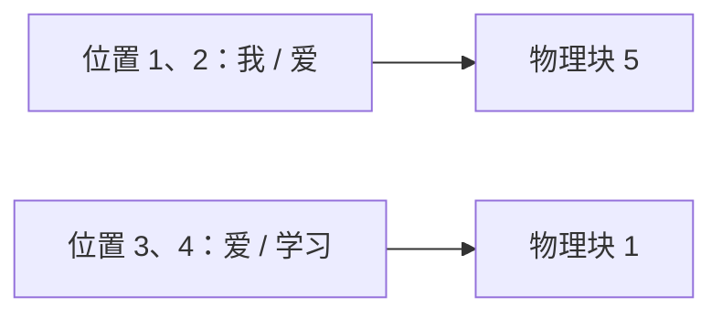

# 从一个生成例子理解 KV Cache 与 vLLM

[上一篇文章](/notes/ai-infra/llm/transformer-math/)中，我们给模型输入 `我 爱`，算出下一个 token 的概率，选择了概率最大的 `爱`。

现在输入变成了 `我 爱 爱`，要继续预测下一个 token。相比上一轮，只多了最后一个 `爱`。

**前面两个 token 已经算过了，能不能直接用上次的结果？**

这篇文章就从这里开始。我们先跟着同一个小模型生成下一个 token，再看留下的计算结果如何占用显存、如何分块存放，最后引出 vLLM。

## 1. 上一轮已经算出了什么

### 1.1 先把两行 K/V 放在眼前

沿用前文的模型：一个 Transformer 层、两个注意力头。为了看清缓存怎样变化，先只展开**第一个头**。这个头的每条 Q、K、V 向量都只有两个数。

处理完 `我 爱` 后，第一个头已经算出：

| 位置 | token | Key：供后面的 Query 匹配 | Value：供注意力汇总 |
| --- | --- | --- | --- |
| 1 | `我` | `[1, 1]` | `[1, 2]` |
| 2 | `爱` | `[1.5403, 0.8415]` | `[0.8415, 3.0806]` |

这些数来自上一篇的输入向量和投影矩阵。这里把已有结果接过来使用，后面新增一行时会实际算一次。小数一般保留四位，后续计算使用未舍入值。

把 Key 那一列上下排起来，就是 K 矩阵；把 Value 那一列上下排起来，就是 V 矩阵：

$$
K\approx\begin{bmatrix}1&1\\1.5403&0.8415\end{bmatrix},\qquad
V\approx\begin{bmatrix}1&2\\0.8415&3.0806\end{bmatrix}
$$

**每行对应一个位置，每行的两个数是这个头的特征。** K 和 V 都有两行，因为已经处理了两个 token。

### 1.2 下一轮，哪些内容重复了

前文采用的直接做法，是把完整序列重新输入模型：

```text
上一轮：我  爱       → 生成 爱
这一轮：我  爱  爱   → 继续预测
        └───┘
      这两个位置已经算过
```

重新处理完整序列，会再次计算前两个位置的 Q/K/V、注意力输出和后面的 FFN。新增位置当然需要计算，但旧位置是否也需要重算，要看追加 token 后，它们的结果会不会变化。

## 2. 新增一个 token，旧的两行会变吗

回想上一篇的因果 mask：**一个位置只能看自己和前面的位置，不能看后面的位置。**

将第 3 个位置的 `爱` 追加到末尾后，各位置能看到的内容是：

| 位置 | 追加之前能看见 | 追加之后能看见 | 是否变化 |
| --- | --- | --- | --- |
| 1：`我` | `我` | `我` | 没变 |
| 2：`爱` | `我 爱` | `我 爱` | 没变 |
| 3：新 `爱` | 尚不存在 | `我 爱 爱` | 需要新算 |

对于前两个位置，token 没变，位置没变，能读取的上下文也没变。推理时模型参数固定，因此它们会算出与上一轮相同的结果。

这不只适用于第一层。如果第一层的旧位置输出没变，第二层收到的旧输入也没变；继续往后推，每一层都成立。这里假定使用因果注意力，并保持已有前缀、位置编码规则和推理设置不变。

因此，我们可以把每一层已经算好的 K/V 留下来，下一轮直接读取。**留下来的这些 K/V，就叫 KV Cache。** [Hugging Face 缓存说明](https://huggingface.co/docs/transformers/main/cache_explanation)

在我们的第一个头里，缓存就是上一节那两张两行两列的表。接下来看看，怎样用这两张表生成下一个 token。

## 3. 只算新增的 `爱`，一步步得到下一个 token

### 3.1 先算新位置的 Q、K、V

新 token 还是 `爱`，但它现在位于第三个位置，位置编号为 2。沿用前文的 embedding 和位置编码，得到输入向量：

$$
z_3\approx[0.9093,\ 0.5839,\ 1.0200,\ 0.9998]
$$

这个向量来自 `爱` 的 embedding `[0, 1, 1, 0]`，加上位置编号 2 的向量。相同 token 出现在不同位置时，输入向量可以不同，所以不能把第 2 个位置的 `爱` 的 K/V 直接当成第 3 个位置的 `爱` 的 K/V。

前文给第一个头设置的投影矩阵，作用很简单：

| 要计算什么 | 对输入向量做什么 | 新位置的结果 |
| --- | --- | --- |
| Query | 取前两个数 | `[0.9093, 0.5839]` |
| Key | 把前两个数交换顺序 | `[0.5839, 0.9093]` |
| Value | 取前两个数，第二个乘 2 | `[0.9093, 1.1677]` |

例如 Value 的第二个数约为 $0.583853\times2\approx1.1677$。这仍然是在做前文的 $Q=XW_Q$、$K=XW_K$、$V=XW_V$，只是现在 X 只有新位置这一行。

### 3.2 把新 K/V 接到缓存后面

已有的两行不动，只新增第三行：

| 位置 | token | Key | Value | 从哪里来 |
| --- | --- | --- | --- | --- |
| 1 | `我` | `[1, 1]` | `[1, 2]` | 上一轮留下的 |
| 2 | `爱` | `[1.5403, 0.8415]` | `[0.8415, 3.0806]` | 上一轮留下的 |
| 3 | 新 `爱` | `[0.5839, 0.9093]` | `[0.9093, 1.1677]` | 本轮新算的 |

现在缓存里有三个位置。接下来，新 Query `[0.9093, 0.5839]` 要决定：从这三个 Value 中各取多少信息。

### 3.3 新 Query 分别与三个 Key 比较

先用新 Query 与每个 Key 做点积，再除以 $\sqrt2$。除以 $\sqrt2$，是因为这个头的 Q/K 向量有两个分量，与上一篇的缩放规则相同。

例如与第一个 Key `[1, 1]` 的计算是：

$$
\frac{0.9093\times1+0.5839\times1}{\sqrt2}\approx1.0558
$$

对三个 Key 分别计算：

| 来源位置 | 点积后缩放 | 得到的分数 |
| --- | --- | --- |
| 1：`我` | $(0.9093\times1+0.5839\times1)/\sqrt2$ | 约 1.0558 |
| 2：旧 `爱` | $(0.9093\times1.5403+0.5839\times0.8415)/\sqrt2$ | 约 1.3378 |
| 3：新 `爱` | $(0.9093\times0.5839+0.5839\times0.9093)/\sqrt2$ | 约 0.7508 |

表中结果按未舍入的输入计算，直接代入展示的小数时，末位可能略有差别。

这一步只计算了**新 Query 与三个 Key 的关系**。旧位置的 Query 不需要再来查询一遍。

### 3.4 把三个分数变成三个权重

分数还不能直接拿来加权，需要像前文一样做 softmax：先取指数，再除以总和。

| 来源位置 | 分数 | 分数取指数 | 除以指数总和，得到权重 |
| --- | --- | --- | --- |
| 1：`我` | 1.0558 | 约 2.8743 | 约 0.3265 |
| 2：旧 `爱` | 1.3378 | 约 3.8105 | 约 0.4328 |
| 3：新 `爱` | 0.7508 | 约 2.1187 | 约 0.2407 |

指数总和约为 $2.8743+3.8105+2.1187=8.8035$。例如第一个权重为：

$$
\frac{2.8743}{8.8035}\approx0.3265
$$

三个权重加起来约为 1。它们表示：新位置从 `我` 取约 32.65%，从旧 `爱` 取约 43.28%，从自己取约 24.07%。

### 3.5 按权重汇总三个 Value

还是前文的做法：**每个 Value 整条向量乘上自己的权重，再把三个向量相加。**

$$
\begin{aligned}
o_3
&\approx0.3265[1,2]\\
&\quad+0.4328[0.8415,3.0806]\\
&\quad+0.2407[0.9093,1.1677]\\
&\approx[0.9096,2.2674]
\end{aligned}
$$

也可以把两个分量分别算出来：

| 输出分量 | 怎样计算 | 结果 |
| --- | --- | --- |
| 第一个数 | $0.3265\times1+0.4328\times0.8415+0.2407\times0.9093$ | 约 0.9096 |
| 第二个数 | $0.3265\times2+0.4328\times3.0806+0.2407\times1.1677$ | 约 2.2674 |

至此，第一个头完成了本轮的注意力计算。旧 K/V 从缓存中读取，新 Q/K/V 只算了一行。

### 3.6 接回完整模型，选出 `学习`

我们刚才只展开了第一个头。第二个头也按同样的方式，读取自己的 K/V 缓存，得到约 `[0.8159, 1.9998]`。

把两个头的结果拼在一起，得到四维向量：

$$
[0.9096,2.2674,0.8159,1.9998]
$$

接着执行上一篇讲过的输出投影、残差连接、LayerNorm、FFN 和词表投影。计算规则与参数都不变，只需要处理新位置这一行。得到的五个 logits 约为：

$$
[-1.0276,-0.0894,0.1524,-1.9027,1.1170]
$$

再做一次词表 softmax：

| 候选 token | 概率 |
| --- | --- |
| `我` | 约 6.34% |
| `爱` | 约 16.21% |
| `你` | 约 20.64% |
| `<eos>` | 约 2.64% |
| `学习` | 约 54.16% |

于是选出 `学习`。这与上一篇重新输入整个 `我 爱 爱` 得到的结果相同。

**我们保留了相同的预测结果，同时省去了前两个位置的重复计算。**

## 4. 下一轮继续做同样的事

### 4.1 再追加一行，就能继续生成

下一轮把刚生成的 `学习` 输入模型。它是第四个位置，第一个头新算出的 K/V 为：

| 新增位置 | Key | Value |
| --- | --- | --- |
| 4：`学习` | `[-0.9900, 0.1411]` | `[0.1411, -1.9800]` |

将它们加到缓存后面，缓存从三行变成四行。新 Query 读取这四行 K/V，两个头完成注意力，再经过后面的模块。这一轮又选出 `学习`，与前文一致。

整个生成过程现在是：

| 调用 | 本次真正输入模型的内容 | 已有缓存 | 本轮输出 | 计算后缓存的内容 |
| --- | --- | --- | --- | --- |
| 第一轮 | `我 爱` | 空 | `爱` | 位置 1、2 |
| 第二轮 | 第三个位置的 `爱` | 位置 1、2 | `学习` | 位置 1、2、3 |
| 第三轮 | 第四个位置的 `学习` | 位置 1、2、3 | `学习` | 位置 1、2、3、4 |

最后的文本是 `我 爱 爱 学习 学习`。第五个 token 刚被选出来，还没有送入模型，因此缓存目前只有四个位置；如果继续生成，下一轮才会计算它的 K/V。

### 4.2 这就引出了 Prefill 和 Decode

第一轮需要处理用户给出的完整输入，并建立缓存，叫 **Prefill**。

后面的轮次使用已有缓存，每次处理一个新 token，叫 **Decode**。

现在这两个名字可以对应到具体动作：先把 `我 爱` 的两行 K/V 填好，再一轮一轮往后添加一行。

如果还用“每轮完整重算”的方式，三轮要依次处理 2、3、4 个位置；使用缓存后，则处理 2、1、1 个新位置：

| 比较项 | 每轮完整重算 | 使用 KV Cache |
| --- | --- | --- |
| 各轮需要做投影和 FFN 的位置数 | 2、3、4 | 2、1、1 |
| 三轮合计 | 9 个位置 | 4 个位置 |
| 是否还要让新 Query 读取历史 K/V | 要 | 仍然要 |

这个计数说明重复工作减少了，不能直接换算成生成速度的倍数。它也提醒我们：**缓存省掉了重新计算旧内容，但新 token 仍要读取旧内容。**

### 4.3 为什么不把旧 Query 也留着

回看第二轮的实际计算：我们拿新 Query `[0.9093, 0.5839]` 去查询三个 Key，再汇总三个 Value。整个过程没有用到旧位置的 Query。

旧 Query 已经完成了旧位置的查询任务。以后每个新位置都有自己的 Query，所以普通增量解码主要需要长期保存 K 和 V。

同理，第二轮算出的三个注意力权重也不能直接交给第三轮使用。第三轮的 Query 不同，权重需要重新计算。

## 5. 留下这些 K/V，要花多少显存

### 5.1 先数清这个小模型存了多少个数

前面为了方便观察，只展示了第一个头。整个模型有两个头，每个头都要存 Key 和 Value，每条向量都有两个数。

因此，一个 token 需要保存：

$$
2\times2\times2=8
$$

假设每个数用 FP32 存储，占 4 字节，一个 token 的缓存就是 $8\times4=32$ 字节。这里模型只有一层；如果有多层，每层都要保存自己的 K/V。

| 时刻 | 已缓存位置数 | 数值个数 | K/V 大小 |
| --- | --- | --- | --- |
| 第一轮结束 | 2 | 16 | 64 字节 |
| 第二轮结束 | 3 | 24 | 96 字节 |
| 第三轮结束 | 4 | 32 | 128 字节 |

每处理一个新 token，缓存就多出 32 字节。我们的例子很小，但真实模型的每个 token 要留下的数远不止 8 个。

### 5.2 把同一笔账放大

假设另一个模型有 32 层，每层有 32 个独立的 K/V 头，每个头的 Key 和 Value 各有 128 个数，每个数占 2 字节。仍然按刚才的方法相乘：

$$
32\times32\times2\times128\times2
=524\,288\text{ bytes}=512\text{ KiB}
$$

这只是**一个 token** 的缓存。如果一个请求已经缓存 8192 个 token，就需要 $8192\times512\text{ KiB}=4\text{ GiB}$。

16 个这样的请求，仅 K/V 就需要 64 GiB，还没有算模型权重和临时数据。这里用 $1\text{ GiB}=2^{30}$ 字节计，是特定模型配置下的容量算例；其他模型要按实际 K/V 结构来数。

于是，新的问题出现了：**减少重复计算之后，缓存本身可能占掉大量显存，限制同时服务的请求数量。**

### 5.3 缓存放得下，也仍要读出来

第二轮生成 `学习` 时，我们虽然没有重算前两个位置的 K/V，却仍然读取了它们，才能完成三个点积和三个 Value 的加权求和。

第三轮需要读四个位置；如果上下文有八千个位置，新 Query 就要使用这八千个位置的 K/V。对于这里讨论的完整注意力，缓存越长，每轮需要访问的历史数据也越多。

这解释了为什么“已经使用 KV Cache”不等于“推理就不会慢”：除了新 token 的计算，还要花时间从显存读取模型权重和历史 K/V。

## 6. 缓存越长越大，怎样给它分配空间

### 6.1 先看一种直观但浪费的办法

回到每 token 占 32 字节的小模型。

我们不知道一个请求最终会生成多长，最容易想到的办法是：一开始给它预留 8 个位置。这样不必每生成一个 token 就重新找空间。

但主算例处理到第四个位置时，实际只需要 128 字节，预留的空间却有 $8\times32=256$ 字节，其中一半还没用上。

多个请求同时存在时，这些预留空位会累积起来。我们希望新 token 到来时再增加容量，同时尽量避免搬移已有的 K/V。

### 6.2 改成每两个 token 分配一块

假设每个块放两个 token 的 K/V。在这个小模型里，一块就占 $2\times32=64$ 字节。

先给 `我 爱` 分配一块，编号为 5：

```text
第一轮结束：
块 5：[位置 1：我][位置 2：爱]
```

第二轮输入新 `爱` 时，块 5 已经满了，再拿一块空闲块，假设编号为 1：

```text
第二轮结束：
块 5：[位置 1：我][位置 2：爱]
块 1：[位置 3：爱][   空位   ]
```

第三轮输入 `学习`，直接填进块 1 的剩余位置：

```text
第三轮结束：
块 5：[位置 1：我][位置 2：爱]
块 1：[位置 3：爱][位置 4：学习]
```

图里的 token 用来标记位置，块中实际存的是这些位置对应的 K/V 数值。

| 时刻 | 实际 K/V 数据 | 已分配容量 | 还有多少空位 |
| --- | --- | --- | --- |
| 第一轮结束 | 64 字节 | 1 块，64 字节 | 0 |
| 第二轮结束 | 96 字节 | 2 块，128 字节 | 1 个位置，32 字节 |
| 第三轮结束 | 128 字节 | 2 块，128 字节 | 0 |

新增容量以块为单位，所以仍可能有一点空位。不过不必提前给这个请求预留整段最大长度，已有块也可以继续留在原处。

### 6.3 不挨着存，模型怎样找到它们

从句子的角度，四个位置仍然按顺序排列；从存储的角度，前两个位置放在块 5，后两个位置放在块 1。

只需要为这个请求保留一张很小的**块表**：

| 句子里的哪一段 | 存在哪里 |
| --- | --- |
| 第 1、2 个位置 | 物理块 5 |
| 第 3、4 个位置 | 物理块 1 |

这张表也可以记为 `[5, 1]`。



比如要读取第四个位置的 Value，先查出它在块 1，再读取块里的第二个位置。物理块不必紧挨着，但位置顺序仍然清楚。

这就引出了 **PagedAttention**：把 K/V 分块存储，通过块表找到它们，让注意力计算能够读取这些分散的块。[PagedAttention 论文 §4](https://arxiv.org/html/2309.06180v1#S4)

### 6.4 分块之后，注意力还是刚才那笔计算

拿第二轮生成 `学习` 的过程来看。当时块 5 保存前两个位置，块 1 保存第三个位置。

新 Query 仍然会得到刚才的三个分数，统一做 softmax 后，权重仍是约 0.3265、0.4328、0.2407。读取 Value 时，只是前两个去块 5 取，第三个去块 1 取。

最后仍然计算第 3.5 节的那三个加权项，得到约 `[0.9096, 2.2674]`。

**变化的是数据存在哪里；参与计算的 K/V、位置顺序和注意力规则都不变。** 各块也不能各自单独归一化后直接相加，权重仍要覆盖全部可见位置。

## 7. 多个请求一起生成，才需要进一步考虑调度

### 7.1 为什么要把多个请求放在一起

一个请求的下一个 token，必须等当前 token 选出来后才能继续算。但不同用户的请求之间没有这种依赖。

所以，可以把 A、B、C 三个请求放在同一批里，每个请求各推进一个 token。它们使用同一套模型权重，GPU 可以在一次批处理内更好地复用这些权重，并行处理更多工作。

每个请求仍有自己的 K/V 和块表。例如，A 用块 `[5, 1]`，B 和 C 使用其他块。批处理让它们一起计算，不会让它们的上下文混在一起。

这里又出现了一个联系：**更大的批次通常更有利于复用权重，但更多请求也需要更多 K/V 空间。** 缓存分配越紧凑，就越有机会容纳更多请求。

### 7.2 一个请求结束后，空位可以马上交给下一个

假设 A、B、C 都已完成初始输入的处理，接下来分别还需要 2、1、3 次 decode。A 就对应我们的主算例：第一轮已经生成 `爱`，还要生成两个 `学习`。

如果等待整批结束后才接下一批，过程是：

| Decode 轮次 | 槽位 1 | 槽位 2 | 槽位 3 |
| --- | --- | --- | --- |
| 1 | A | B，随后结束 | C |
| 2 | A，随后结束 | 空 | C |
| 3 | 空 | 空 | C，随后结束 |

B 很快结束，但它留下的槽位要等 C 完成才能再次使用。

更灵活的做法是：每轮结束后重新看看哪些请求还要继续，哪些已经结束，有没有新请求可以进入。比如 B 结束后，下一轮就可以安排新请求 D 的工作。

这叫 **Continuous batching，连续批处理**。它按一次次迭代调整请求集合，而不是把一组请求固定到全部结束。分页管理让请求的缓存更容易按需增长和释放，两者可以配合使用。[PagedAttention 论文 §2.3](https://arxiv.org/html/2309.06180v1#S2.SS3)

D 如果还没有缓存，就需要先处理自己的输入，不能直接开始 decode。若 D 的输入很长，可以把它的 prefill 分成几段，在后续轮次中逐步处理，让已经在输出的请求也能继续推进。这就是 **Chunked prefill** 的基本用途。[vLLM 调优文档](https://docs.vllm.ai/en/latest/configuration/optimization/#chunked-prefill)

### 7.3 现在再看 vLLM 在做什么

到这里，我们已经遇到了几件需要一起处理的事情：

| 本轮发生的事情 | 引擎需要做什么 |
| --- | --- |
| A 输入新的 `爱`，缓存要多一行 | 找到可写的位置，必要时分配新块 |
| A 的 Query 要读取历史 K/V | 根据 A 的块表读取对应的数据 |
| B 已经生成完毕 | 结束请求，释放它对缓存块的引用 |
| D 正在等待 | 根据可用空间和本轮计算预算，安排它开始或继续处理 |

**vLLM 是负责执行模型推理，并协调这些缓存与调度工作的引擎。** KV Cache 是其中复用历史结果的基础，分页让缓存更容易管理，调度器则决定这一轮让哪些请求处理多少 token。[vLLM V1 指南](https://docs.vllm.ai/en/latest/usage/v1_guide/)

这里的分页和调度保留了原来的注意力计算。vLLM 主要改善的是：相同的模型计算，怎样在显存和计算资源有限时服务更多请求。

## 8. 如果两个请求都有相同前缀，还能再省一点

最后再沿着同一个例子走一步。

假设 A 和 B 的输入都以 `我 爱` 开头，使用同一个模型和相同的位置设置。第 2 节已经解释过，这两个位置的 K/V 只取决于相同的前缀，因此算出的结果相同。

若这份缓存仍然保留着，B 可以复用已有的前缀块。A 和 B 的块表可以同时指向块 5：

| 请求 | 第 1、2 个位置 | 后续内容 |
| --- | --- | --- |
| A | 公共块 5：`我 爱` 的 K/V | 使用自己的后续块 |
| B | 同一个公共块 5 | 使用自己的后续块 |

在我们的小模型里，这个公共块占 64 字节。各自保存需要 128 字节，共享一份只需 64 字节，也可以省去命中前缀的重复 prefill。

这种跨请求复用相同前缀 K/V 的机制，叫 **Prefix caching**。vLLM 的 Automatic Prefix Caching 会在满足匹配条件时利用已有前缀缓存。[vLLM 前缀缓存说明](https://docs.vllm.ai/en/latest/features/automatic_prefix_caching/)

这里必须是相同的前缀及相容的模型设置。仅仅在两个不同句子中都出现 `爱`，不能据此共享它的 K/V。缓存也可能被淘汰；即使命中，后续新 Query 仍然要读取这些 K/V 做注意力。

沿着这个例子，我们先留下两行 K/V，随后每轮只增加一行；再把这些行分块存放，按请求记录块表；最后让多个请求共同参与调度，并在条件合适时共享前缀。这些动作组成了从 KV Cache 到 vLLM 的主要思路。

## 9. 完整算例与参考资料

想核对前文模型的全部参数、两个头和后续 FFN，可以下载<a href="/examples/llm/kv_cache_walkthrough.py" download="kv_cache_walkthrough.py">完整计算脚本</a>。它只依赖 Python 标准库：

```bash
python3 kv_cache_walkthrough.py
```

脚本会分别进行完整重算和增量缓存计算，检查中间结果与最终概率是否一致，并打印三轮的具体数值。加上 `--json` 可以得到未舍入的完整数据。脚本使用 Python 浮点数计算，本文的 FP32 用于容量核算；这些手算参数用于讲解过程，不代表真实模型的语言能力或 GPU 性能。

进一步阅读：

1. [Hugging Face：How caching works](https://huggingface.co/docs/transformers/main/cache_explanation)：缓存每层 K/V 后，后续生成如何进行。
2. [PagedAttention 论文](https://arxiv.org/abs/2309.06180)：分块管理缓存、共享与请求调度的原始设计。
3. [vLLM V1 指南](https://docs.vllm.ai/en/latest/usage/v1_guide/)与[调优文档](https://docs.vllm.ai/en/latest/configuration/optimization/)：引擎如何组织实际请求。本文说明依据 2026 年 11 月 9 日查阅的官方资料。
