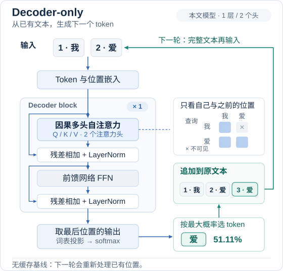
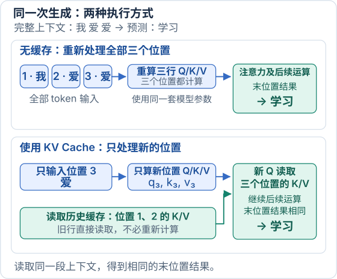
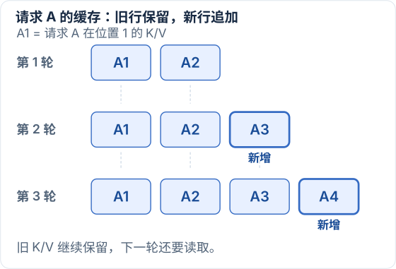
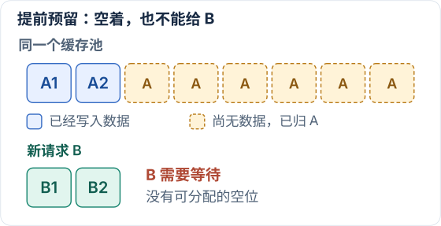
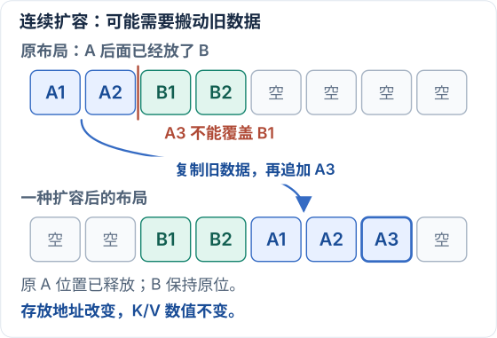
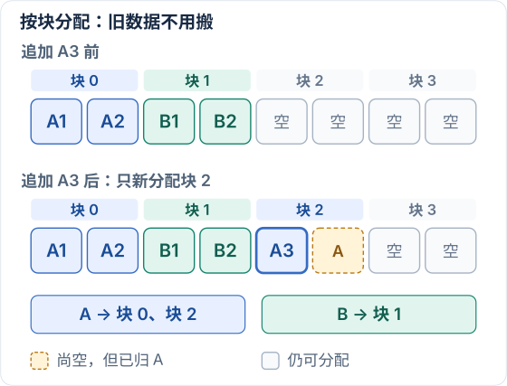
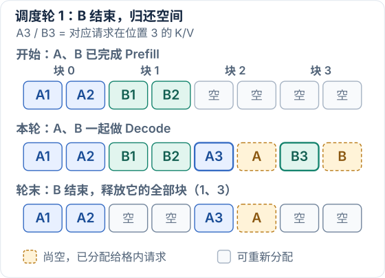
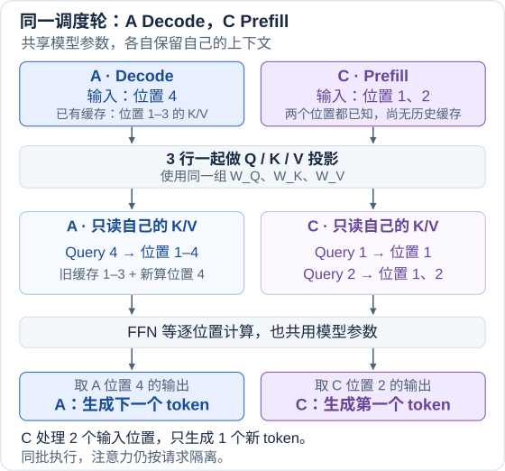
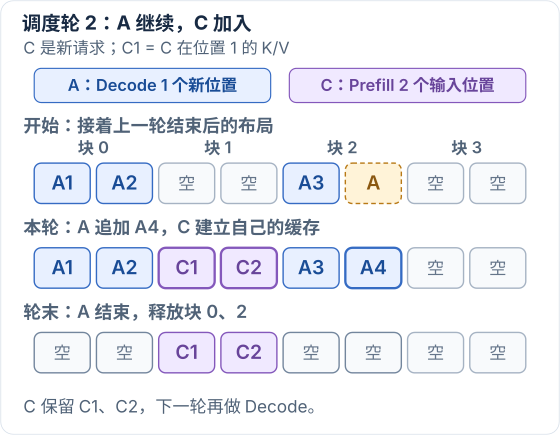
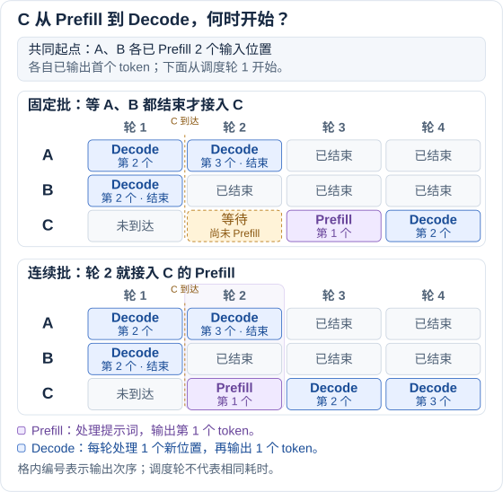

# 从数学角度理解 vLLM

[上一篇](/notes/ai-infra/llm/transformer-math/)拆开了 Transformer 的计算。这篇沿用同一个生成例子，先看模型怎样运行，再依次解决重复计算、缓存占用显存、请求等待这三个问题，最后把它们接到 vLLM。

## 1. 先看全局：Decoder-only 怎样逐个生成 token

先沿**蓝色箭头**看本轮计算：`我 爱` 变成带位置信息的向量，经过 Decoder block，**最后一个位置的输出用于预测下一个 token**。本例选出 `爱`。再沿**绿色箭头**看生成循环：把它追加成 `我 爱 爱`，整段文本进入下一轮。

图中沿用上一篇的**单层、两个注意力头**教学模型。参数是为演示手选的，所以生成的语句不一定自然。这里先按“每轮重新处理整段文本”运行，下面就从中找出重复计算。

## 2. 第一个问题：无缓存时，哪些计算被重复了

### 2.1 每轮只多一个 token，却重新处理整段输入

先采用最直接的实现：保留已有文本和模型参数，每轮把完整文本重新送入模型，不保存中间的 Q/K/V。

| 轮次 | 送入模型的文本 | 本轮重新处理的位置 | 选出的下一个 token |
| --- | --- | --- | --- |
| 第一轮 | `我 爱` | 位置 1、2 | `爱`，概率约 51.11% |
| 第二轮 | `我 爱 爱` | 位置 1、2、3 | `学习`，概率约 54.16% |

第二轮只有位置 3 是新加入的，位置 1、2 的 token 和位置都没变，程序却重新处理了它们。**优化的切入点，就是找出这些旧位置哪些结果没有改变，可以留给下一轮复用。**

### 2.2 Q/K/V：输入追加一行，旧投影不变

下面的 X_old、X_new 描述无缓存实现实际处理的整段输入。一个位置对应一个行向量：x₁ 是位置 1 的 `我`，x₂ 是位置 2 的 `爱`，x₃ 是新加入的、位置 3 的 `爱`。第一轮的输入有两行，第二轮有三行：

$$
\begin{aligned}
X_{\mathrm{old}}&=\begin{bmatrix}x_1\\x_2\end{bmatrix}\\
X_{\mathrm{new}}&=\begin{bmatrix}x_1\\x_2\\x_3\end{bmatrix}
=\begin{bmatrix}X_{\mathrm{old}}\\x_3\end{bmatrix}
\end{aligned}
$$

**old/new 表示前后两轮，不是前后两层。** 上下排列表示把新行接在旧矩阵下面。虽然位置 2、3 都是 `爱`，它们的位置编码不同，因此 x₂ 和 x₃ 不同。

以下仍看第一层的同一个注意力头。它用固定参数计算 $Q=XW_Q$、$K=XW_K$、$V=XW_V$；W 是模型参数，Q/K/V 是输入对应的计算结果。

**Q**

$$
\begin{aligned}
Q_{\mathrm{new}}&=\begin{bmatrix}X_{\mathrm{old}}\\x_3\end{bmatrix}W_Q\\
&=\begin{bmatrix}X_{\mathrm{old}}W_Q\\x_3W_Q\end{bmatrix}\\
&=\begin{bmatrix}Q_{\mathrm{old}}\\q_3\end{bmatrix}
\end{aligned}
$$

上面一块是旧的两行输入乘 W_Q，得到 Q_old；下面一块是新输入 x₃ 乘 W_Q，得到 q₃。**新输入没有参与前两行 Q 的计算。**

**K**

$$
\begin{aligned}
K_{\mathrm{new}}&=\begin{bmatrix}X_{\mathrm{old}}\\x_3\end{bmatrix}W_K\\
&=\begin{bmatrix}X_{\mathrm{old}}W_K\\x_3W_K\end{bmatrix}\\
&=\begin{bmatrix}K_{\mathrm{old}}\\k_3\end{bmatrix}
\end{aligned}
$$

前两行仍然是同一个 X_old 乘同一个 W_K，结果仍是 K_old；第三行才是这轮新增的 k₃。

**V**

$$
\begin{aligned}
V_{\mathrm{new}}&=\begin{bmatrix}X_{\mathrm{old}}\\x_3\end{bmatrix}W_V\\
&=\begin{bmatrix}X_{\mathrm{old}}W_V\\x_3W_V\end{bmatrix}\\
&=\begin{bmatrix}V_{\mathrm{old}}\\v_3\end{bmatrix}
\end{aligned}
$$

三个等式说的是同一件事：**旧输入和参数不变，旧 Q/K/V 就不变；输入追加一行，投影结果也只追加一行。**

这里是在描述结果的组成。无缓存程序仍然把旧块重新算了一次，并没有因为我们把矩阵分块写出来，就自动保存或复用数据。

**这里用到的矩阵法则**

这里用到的是**分块矩阵乘法法则，具体是按行分块的情形**。把一个矩阵按行拆成上面的 B 和下面的 C，右乘同一个 W，可以写成：

$$
\begin{bmatrix}B\\C\end{bmatrix}W
=\begin{bmatrix}BW\\CW\end{bmatrix}
$$

条件是：**B、C 的列数相同，并且等于 W 的行数。** B、C 的行数可以不同。套回本例：

| 矩阵 | 形状 | 含义 |
| --- | --- | --- |
| B，也就是 X_old | `2 × 4` | 两个旧位置，每个位置四个特征 |
| C，也就是 x₃ | `1 × 4` | 一个新位置，也有四个特征 |
| W_Q、W_K 或 W_V | `4 × 2` | 将四维输入变成这个头的二维表示 |
| 拼接后相乘的结果 | `3 × 2` | 两行旧结果，加一行新结果 |

它直接来自矩阵乘法的定义：**结果的第 i 行，是左边矩阵的第 i 行分别与 W 的各列做点积。** 计算第 1 行，只会用 x₁；计算第 2 行，只会用 x₂；计算第 3 行，才会用 x₃。因此可以先算上面的两行，再算下面的一行，最后按原顺序拼起来。教材中也称为矩阵乘积的“按行解释”。[参考 3](#ref-matrix)

这里的上下分块是**拼接**，不是 B + C。本例的 `2 × 4` 和 `1 × 4` 两块本来就不能直接做矩阵相加，所以应当称为分块矩阵乘法，而不是把它写成普通的加法分配律。

这条法则对一般 W 都成立，不要求 W 里有很多 0 和 1。本例手选的参数只影响具体数值，不影响三个分块等式。

仅靠这条分块乘法规则，我们证明的是：**同一层的旧输入不变，旧 Q/K/V 就不变。** 接下来从 Q/K 算出注意力权重 A，再得到输出 O。

### 2.3 从注意力权重到输出：因果遮罩让旧行保持不变

**先由 Q/K 算出权重 A**

**A 是根据当前 Q/K 计算出来的权重矩阵。** 它的第 i 行表示：位置 i 要按什么比例汇总各个位置的 V。它不是预先给定的模型参数。

从 Q/K 到 O，完整的计算链是：

$$
\begin{aligned}
S&=\frac{QK^\top}{\sqrt2}+M\\
A&=\operatorname{softmax}_{\mathrm{row}}(S)\\
O&=AV
\end{aligned}
$$

顺着这三行读：

- **Q/K 算匹配分数**：Q 的第 i 行与 K 的第 j 行做点积，给“位置 i 读取位置 j”打分。本例每个头的 Q/K 有两个分量，因此除以 √2 控制分数尺度。
- **M 限定可见范围**：允许读取的位置加 0，未来位置加负无穷。S 记录的是加过因果 mask 的分数。
- **softmax 将分数变成权重**：下标 row 表示每行单独处理；先取指数，再除以这一行的指数总和，得到总和为 1 的权重。最后按这些权重汇总 V，才得到 O。

例如，同一个例子中，位置 3 的三个分数约为 `[1.0558, 1.3378, 0.7508]`，softmax 后得到权重行 a₃，约为 `[0.3265, 0.4328, 0.2407]`。这三个数是汇总三个输入位置的比例，与候选词的生成概率不同。

旧输入和参数不变时，旧位置之间的分数不变；对于旧位置，新位置被因果 mask 屏蔽，新增指数项为 0，所以旧行的 softmax 分母和权重都不变。两轮的 A 分别为：

$$
\begin{aligned}
A_{\mathrm{old}}&\approx\begin{bmatrix}
1&0\\
0.4629&0.5371
\end{bmatrix}\\
A_{\mathrm{new}}&\approx\begin{bmatrix}
1&0&0\\
0.4629&0.5371&0\\
0.3265&0.4328&0.2407
\end{bmatrix}
\end{aligned}
$$

**A_new 的前两行，就是 A_old 右边补上一列 0；第三行才是新位置的 a₃。** 这就接上了下面 O 的分块公式。

**再用权重汇总 V，得到 O**

前面的 Q/K/V，是每个位置的输入乘固定参数。到了 $O=AV$，我们用 A 给出的比例，汇总不同位置的 V。

**A 的第 i 行，决定 O 的第 i 行；这一行的第 j 个数，乘的是 V 的第 j 行。** 把 V 的各行记作 v₁、v₂、v₃，它们每个都是一条含两个数的向量。例如，本例中 v₁ 是 `[1, 2]`，v₂ 约为 `[0.8415, 3.0806]`。

**先只看位置 2。** 第一轮的 A 第二行是 `[0.4629, 0.5371]`，意思是：取 46.29% 的 v₁，加上 53.71% 的 v₂。矩阵乘法展开后就是：

$$
\begin{aligned}
o_{2,\mathrm{old}}
&\approx[0.4629,0.5371]\begin{bmatrix}v_1\\v_2\end{bmatrix}\\
&=0.4629v_1+0.5371v_2\\
&\approx[0.9148,2.5804]
\end{aligned}
$$

这里得到的仍是一条含两个数的向量，它就是 O 的第二行。下面的小数显示到四位，结果由未舍入值计算。

**第二轮加入位置 3 后，位置 2 会发生什么？** 上面已经得到：它的权重行从 `[0.4629, 0.5371]` 变成 `[0.4629, 0.5371, 0]`。因此：

$$
\begin{aligned}
o_{2,\mathrm{new}}
&\approx[0.4629,0.5371,0]\begin{bmatrix}v_1\\v_2\\v_3\end{bmatrix}\\
&=0.4629v_1+0.5371v_2+0v_3\\
&\approx[0.9148,2.5804]
\end{aligned}
$$

**原来的两个 V 没变，原来的两个权重也没变，只多了一个零项，所以位置 2 的输出不变。** 因果 mask 保证位置 2 不能读取位置 3，正是这个限制让新增项的权重为 0。

位置 1 同理：它的权重从 `[1, 0]` 变成 `[1, 0, 0]`，输出一直是 v₁。

**位置 3 才需要得到新的输出。** 它使用自己的权重行 `[0.3265, 0.4328, 0.2407]`，汇总全部三个 V：

$$
\begin{aligned}
o_3&\approx0.3265v_1+0.4328v_2+0.2407v_3\\
&\approx[0.9096,2.2674]
\end{aligned}
$$

这里新增的 v₃ 约为 `[0.9093, 1.1677]`。o₃ 的计算仍然需要 v₁、v₂；对应的权重也需要用 q₃ 与全部 K 重新匹配。

现在把三行结果放回同一个矩阵：

$$
\begin{aligned}
O_{\mathrm{new}}
&=\begin{bmatrix}o_{1,\mathrm{old}}\\o_{2,\mathrm{old}}\\o_3\end{bmatrix}\\
&=\begin{bmatrix}O_{\mathrm{old}}\\o_3\end{bmatrix}
\end{aligned}
$$

**这个分块式，就是把“前两行输出不变、第三行是新输出”合起来写。** 它成立需要两件事：旧 V 不变，以及因果 mask 保证旧位置的权重不变。

这里的 O 是单个注意力头的输出，上式描述整段计算结果的组成。需要核对数值时，可以展开下面的两轮对照；下一节再把这些不变的旧 K/V 实际保存下来。

展开两轮的矩阵结果，核对哪些行被重新计算

沿用上一篇的模型和参数，下面只列第一个头的关键结果，观察哪些行重复了、哪些行是新增的。数字显示到四位小数，计算时使用未舍入的值。

**第一轮：处理两个位置，生成 `爱`**

输入 `我 爱`，两个位置分别计算 Q/K/V，得到：

$$
\begin{aligned}
Q_{\mathrm{old}}&\approx\begin{bmatrix}1&1\\0.8415&1.5403\end{bmatrix}\\
K_{\mathrm{old}}&\approx\begin{bmatrix}1&1\\1.5403&0.8415\end{bmatrix}\\
V_{\mathrm{old}}&\approx\begin{bmatrix}1&2\\0.8415&3.0806\end{bmatrix}
\end{aligned}
$$

两个位置继续经过两个头的注意力和后续 Transformer 运算，最后使用位置 2 的结果预测下一个 token。**本例选出 `爱`，概率约 51.11%，文字变成 `我 爱 爱`。**

第一轮结束后，无缓存程序保留文字和模型参数，不把刚才算出的 Q/K/V 等中间结果交给下一轮复用。

**第二轮：重新处理三个位置，生成 `学习`**

输入变成 `我 爱 爱`。前两个 token 及其位置没有改变，只有位置 3 是新加入的。无缓存程序仍然重新计算全部三行 Q/K/V：

$$
\begin{aligned}
Q_{\mathrm{new}}&\approx\begin{bmatrix}
1&1\\
0.8415&1.5403\\
0.9093&0.5839
\end{bmatrix}\\
K_{\mathrm{new}}&\approx\begin{bmatrix}
1&1\\
1.5403&0.8415\\
0.5839&0.9093
\end{bmatrix}\\
V_{\mathrm{new}}&\approx\begin{bmatrix}
1&2\\
0.8415&3.0806\\
0.9093&1.1677
\end{bmatrix}
\end{aligned}
$$

对照上面的三个分块等式：**每个矩阵的前两行与第一轮完全相同，第三行才是新位置的 q₃、k₃、v₃。** 两个 `爱` 的位置编码不同，所以位置 2、3 的结果不同。

这里的三行都是本轮重新算出的。**结果只是在旧块下面追加新行，无缓存程序却把旧块也重新算了一遍。**

三个位置继续经过注意力和后续运算，最后使用位置 3 的结果预测下一个 token。**本例选出 `学习`，概率约 54.16%，文字变成 `我 爱 爱 学习`。**

**注意力的结果也显示：旧位置被重复计算了**

注意力用每个位置的 Q 与可见位置的 K 打分，经 softmax 得到权重，再按权重汇总 V。因果 mask 限制每个位置只能读取自己和此前的位置。

两轮第一个头的注意力输出分别为：

$$
\begin{aligned}
O_{\mathrm{old}}&\approx\begin{bmatrix}
1&2\\
0.9148&2.5804
\end{bmatrix}\\
O_{\mathrm{new}}&\approx\begin{bmatrix}
1&2\\
0.9148&2.5804\\
0.9096&2.2674
\end{bmatrix}
\end{aligned}
$$

位置 3 读取三个位置的 K/V，得到权重 `[0.3265, 0.4328, 0.2407]`，汇总结果是第三行 `[0.9096, 2.2674]`。这些权重用于汇总已有位置的信息，与选择下一个 token 的概率不同。

**第二轮的前两行输出也与第一轮相同，但程序仍然重新计算了它们。** 第一轮处理两个位置，第二轮从头处理三个位置；重复的不只是 Q/K/V 投影，还包括旧位置的注意力和后续运算。

## 3. KV Cache：只处理新位置，复用历史 K/V

解决重复计算的办法，是把已经算好的旧 K/V 保存下来。先看同一次第二轮的两种执行方式：

**两种方式使用的上下文都包含三个位置。** 有缓存时，历史信息由保存的 K/V 提供；“只新输入一个 token”并不表示注意力只能看到这个 token。

### 3.1 先留下旧 K/V，再加入新的一行

第一轮处理 `我 爱` 后，把两个位置已经算出的 K/V 留下来：

| 已处理的位置 | 留下的 K | 留下的 V |
| --- | --- | --- |
| 1：`我` | k₁ = `[1, 1]` | v₁ = `[1, 2]` |
| 2：`爱` | k₂ = `[1.5403, 0.8415]` | v₂ = `[0.8415, 3.0806]` |

此时刚选出了位置 3 的 `爱`，但还没有处理它，所以缓存只有前两行。**选出 token 之后，要到下一轮将它送入模型，才会得到它自己的 K/V。**

第二轮只新送入这个位置 3。使用它原本的位置编码，得到 x₃ = `[0.9093, 0.5839, 1.0200, 0.9998]`，再计算：

$$
\begin{aligned}
q_3&=x_3W_Q\approx[0.9093,\ 0.5839]\\
k_3&=x_3W_K\approx[0.5839,\ 0.9093]\\
v_3&=x_3W_V\approx[0.9093,\ 1.1677]
\end{aligned}
$$

把新 K/V 接到旧缓存后面：

$$
\begin{aligned}
K_{\mathrm{new}}&=\begin{bmatrix}K_{\mathrm{old}}\\k_3\end{bmatrix}
=\begin{bmatrix}k_1\\k_2\\k_3\end{bmatrix}\\
V_{\mathrm{new}}&=\begin{bmatrix}V_{\mathrm{old}}\\v_3\end{bmatrix}
=\begin{bmatrix}v_1\\v_2\\v_3\end{bmatrix}
\end{aligned}
$$

**上面的旧块直接读取缓存，下面的新行才需要计算。** 现在手里有 1 行新 Q、3 行 K、3 行 V。矩阵中的拼接表达按位置组成的数据，实际存储地址会在第 4 节展开。

### 3.2 用新 Q 查询全部 K/V，得到相同的下一 token

q₃ 分别与三个 K 匹配，得到分数 `[1.0558, 1.3378, 0.7508]`。前两个 K 来自缓存，第三个 K 来自本轮。经 softmax 得到三个权重：

$$
\begin{aligned}
a_3&=\operatorname{softmax}\left(\frac{q_3K_{\mathrm{new}}^\top}{\sqrt2}\right)\\
&\approx[0.3265,\ 0.4328,\ 0.2407]
\end{aligned}
$$

再按这些权重汇总对应的三个 V：

$$
\begin{aligned}
o_3&=a_3V_{\mathrm{new}}\\
&\approx0.3265v_1+0.4328v_2+0.2407v_3\\
&\approx[0.9096,\ 2.2674]
\end{aligned}
$$

这正是第 2 节完整重算得到的第三行。第二个头也只计算新位置，再经过输出投影、残差、LayerNorm 和 FFN，仍选出 `学习`，概率约为 **54.16%**。

**为什么保存 K/V，却不保存 Q？** 本轮要计算的是新位置的输出，所以用的是新 q₃。历史 K/V 是新位置需要读取的信息，而旧 q₁、q₂ 对应的是旧位置的查询，本轮已经不用再计算那些旧输出。因此，后续需要复用的是 K/V。[参考 2](#ref-cache)

### 3.3 为什么只计算一行也等价

完整重算会得到三行 O；缓存方式本轮只得到一行。**我们比较的是“缓存输出”与“完整重算的最后一行”，不是说两个不同大小的 O 矩阵整体相等。** 预测下一个 token 使用的正是这个最后位置。

下面保留完整推导，按无缓存、缓存、代入比较的顺序展开：

展开纯公式证明：缓存输出 = 完整计算的最后一行

**① 无缓存：完整计算，再取第 3 行**

$$
\begin{aligned}
Q_{\mathrm{full}}&=\begin{bmatrix}x_1\\x_2\\x_3\end{bmatrix}W_Q
=\begin{bmatrix}x_1W_Q\\x_2W_Q\\x_3W_Q\end{bmatrix}\\
K_{\mathrm{full}}&=\begin{bmatrix}x_1\\x_2\\x_3\end{bmatrix}W_K
=\begin{bmatrix}x_1W_K\\x_2W_K\\x_3W_K\end{bmatrix}\\
V_{\mathrm{full}}&=\begin{bmatrix}x_1\\x_2\\x_3\end{bmatrix}W_V
=\begin{bmatrix}x_1W_V\\x_2W_V\\x_3W_V\end{bmatrix}
\end{aligned}
$$

$$
\begin{aligned}
O_{\mathrm{full}}
&=\operatorname{softmax}_{\mathrm{row}}\left(
\frac{Q_{\mathrm{full}}K_{\mathrm{full}}^\top}{\sqrt2}
+\begin{bmatrix}
0&-\infty&-\infty\\
0&0&-\infty\\
0&0&0
\end{bmatrix}
\right)V_{\mathrm{full}}\\[6pt]
&=\operatorname{softmax}_{\mathrm{row}}\left(
\begin{bmatrix}
\frac{(x_1W_Q)K_{\mathrm{full}}^\top}{\sqrt2}+[0,-\infty,-\infty]\\[6pt]
\frac{(x_2W_Q)K_{\mathrm{full}}^\top}{\sqrt2}+[0,0,-\infty]\\[6pt]
\frac{(x_3W_Q)K_{\mathrm{full}}^\top}{\sqrt2}+[0,0,0]
\end{bmatrix}
\right)V_{\mathrm{full}}\\[6pt]
&=\begin{bmatrix}
\operatorname{softmax}\left(\frac{(x_1W_Q)K_{\mathrm{full}}^\top}{\sqrt2}+[0,-\infty,-\infty]\right)\\[6pt]
\operatorname{softmax}\left(\frac{(x_2W_Q)K_{\mathrm{full}}^\top}{\sqrt2}+[0,0,-\infty]\right)\\[6pt]
\operatorname{softmax}\left(\frac{(x_3W_Q)K_{\mathrm{full}}^\top}{\sqrt2}+[0,0,0]\right)
\end{bmatrix}V_{\mathrm{full}}\\[6pt]
&=\begin{bmatrix}
\operatorname{softmax}\left(\frac{(x_1W_Q)K_{\mathrm{full}}^\top}{\sqrt2}+[0,-\infty,-\infty]\right)V_{\mathrm{full}}\\[6pt]
\operatorname{softmax}\left(\frac{(x_2W_Q)K_{\mathrm{full}}^\top}{\sqrt2}+[0,0,-\infty]\right)V_{\mathrm{full}}\\[6pt]
\operatorname{softmax}\left(\frac{(x_3W_Q)K_{\mathrm{full}}^\top}{\sqrt2}+[0,0,0]\right)V_{\mathrm{full}}
\end{bmatrix}
\end{aligned}
$$

$$
\begin{aligned}
\left(O_{\mathrm{full}}\right)_{\text{第 3 行}}
&=\operatorname{softmax}\left(
\frac{(x_3W_Q)K_{\mathrm{full}}^\top}{\sqrt2}+[0,0,0]
\right)V_{\mathrm{full}}\\
&=\operatorname{softmax}\left(
\frac{(x_3W_Q)K_{\mathrm{full}}^\top}{\sqrt2}
\right)V_{\mathrm{full}}\\
&=\operatorname{softmax}\left(
\frac{(x_3W_Q)
\begin{bmatrix}x_1W_K\\x_2W_K\\x_3W_K\end{bmatrix}^{\!\top}}{\sqrt2}
\right)
\begin{bmatrix}x_1W_V\\x_2W_V\\x_3W_V\end{bmatrix}
\end{aligned}
$$

**② 有缓存：旧 K/V 加上新一行**

$$
\begin{aligned}
K_{\mathrm{old}}&=\begin{bmatrix}x_1W_K\\x_2W_K\end{bmatrix}\\
V_{\mathrm{old}}&=\begin{bmatrix}x_1W_V\\x_2W_V\end{bmatrix}
\end{aligned}
$$

$$
O_{\mathrm{cache}}
=\operatorname{softmax}\left(
\frac{(x_3W_Q)
\begin{bmatrix}K_{\mathrm{old}}\\x_3W_K\end{bmatrix}^{\!\top}}{\sqrt2}
\right)
\begin{bmatrix}V_{\mathrm{old}}\\x_3W_V\end{bmatrix}
$$

**③ 代入旧 K/V，得到同一个表达式**

$$
\begin{aligned}
O_{\mathrm{cache}}
&=\operatorname{softmax}\left(
\frac{(x_3W_Q)
\begin{bmatrix}K_{\mathrm{old}}\\x_3W_K\end{bmatrix}^{\!\top}}{\sqrt2}
\right)
\begin{bmatrix}V_{\mathrm{old}}\\x_3W_V\end{bmatrix}\\
&=\operatorname{softmax}\left(
\frac{(x_3W_Q)
\begin{bmatrix}x_1W_K\\x_2W_K\\x_3W_K\end{bmatrix}^{\!\top}}{\sqrt2}
\right)
\begin{bmatrix}x_1W_V\\x_2W_V\\x_3W_V\end{bmatrix}\\
&=\left(O_{\mathrm{full}}\right)_{\text{第 3 行}}
\end{aligned}
$$

$$
\boxed{O_{\mathrm{cache}}=\left(O_{\mathrm{full}}\right)_{\text{第 3 行}}}
$$

对每个头得到相同的最后一行后，再经过相同的逐位置运算，就会得到相同的下一 token 概率。本例只有一层；多层模型在每一层分别保存该层的 K/V，新位置也逐层读取对应缓存。[参考 2](#ref-cache)

### 3.4 省掉了哪些工作，还剩下哪些工作

第一轮处理完整输入并建立缓存，叫 **Prefill**；后续利用缓存处理新 token，叫 **Decode**。Decoder-only 是模型结构的名称，Decode 则是这里的执行阶段。

继续处理位置 4 的 `学习` 时，方法不变：只算这一行，读取位置 1～4 的 K/V，模型再次选出 `学习`。三轮需要处理的位置可以直接对比：

| 轮次 | 完整重算：重新做投影和 FFN 的位置 | 使用缓存：做这些计算的位置 |
| --- | --- | --- |
| 第一轮 | 1、2 | 1、2 |
| 第二轮 | 1、2、3 | 只有 3 |
| 第三轮 | 1、2、3、4 | 只有 4 |
| 合计 | 9 个位置 | 4 个位置 |

注意力也从计算整片因果三角形，变成只计算最新一行。第二轮的有效分数从 `1 + 2 + 3 = 6` 个变为 3 个；第三轮从 `1 + 2 + 3 + 4 = 10` 个变为 4 个。

**新 Q 仍然要读取全部可见的历史 K/V。** 上下文越长，这一行就越长；表里的 9 与 4 也不能直接当作加速倍数，模型权重和缓存的读取等工作仍然存在。

现在，重复计算减少了，代价是这些 K/V 必须保留在显存里。接下来的问题就变成：缓存不断增长，多个请求该怎样分配空间？

## 4. 第二个问题：缓存不断增长，怎样分配和读取显存

前面已经知道，旧 K/V 可以直接复用。接下来只看一件事：**这些需要一直保留、又不断增加的数据，在显存里怎么放？**

### 4.1 先看 A：旧数据留下，新数据不断追加

前面的请求 A 处理完输入 `我 爱`，留下 A1、A2。下一轮处理位置 3 的新 `爱`，又留下 A3；再下一轮处理位置 4 的 `学习`，又留下 A4：

本例中新位置仍要读取前面所有位置的 K/V，所以旧格子要留着，每处理一个新位置，就要再留一格。**生成还在继续，缓存就会继续增长。** 多条请求同时生成时，都要在有限的显存中保存各自的数据。

接下来回到 A 只有 A1、A2 的时刻，比较几种放置方法。

### 4.2 先试提前预留：空着的格子也可能不能给别人

为了让 A 以后能一直往后追加，一种简单方法是：按预设的长度上限，先给 A 留出一整段连续空间。

此时另一条请求 B 到了，也需要保存自己的 B1、B2：

图中标着 A 的虚线格子虽然没有数据，却已经分给了 A。这片缓存空间里没有可分配给 B 的格子，B 只能等待。

**这里的问题是过早占住了未来可能需要的空间。** 提前预留是一种分配选择，KV Cache 本身并不要求这样做。

### 4.3 改成需要多少放多少：B 进来了，A 却不好继续往后加

换一种安排：先只给 A 当前需要的格子，再让 B 紧挨着 A 放。这样 B 可以进来，后面也还有空位。

但当 A 需要追加 A3 时，A2 右边已经是 B1。如果程序要求 A 的数据必须连续存放，一种扩容办法就是：把 A1、A2 搬到后面更大的连续空位，再接上 A3。

箭头表示复制已有的 K/V，搬完后原来的两个格子可以重新分配。**A 只增加了一个位置，却可能连旧数据一起搬动。** 以后继续增长，还可能再次遇到同样的问题。连续存放与动态增长之间的矛盾，也是 [参考 4](#ref-pagedattention)中讨论的显存管理问题。

### 4.4 放宽连续存放的要求：旧数据不动，新数据另找一块

仍从上一张图**搬迁前**的布局出发。这次允许 A 的数据分开放：把缓存空间切成固定大小的块，需要时再分配新块。为了画清楚，这里每块放两个位置。

A1、A2 留在块 0，B1、B2 留在块 1。A3 到来时，给 A 分配块 2，把 A3 放进去即可：

块 2 中剩下的一个空位已归 A，下一轮可以放 A4；块 3 则还没有分配，可以交给其他请求。这样既能保留旧数据的地址，也不用一开始就给 A 占住整段最大容量。

分块仍可能留下少量未填满的格子，缓存本身也仍会增长。它改善的是空间的分配方式。

**现在 A 的 K/V 分散在块 0、2，B 的数据在块 1。接下来沿着块表读取 A 的数据，核对结果是否改变。**

### 4.5 沿块表读取同一批 K/V：PagedAttention

A 的前两行在块 0，第三行在块 2，中间夹着 B 的数据。

给 A 留一张地址表就可以了：

| A 的逻辑位置 | 到哪里读 |
| --- | --- |
| 位置 1、2 | 块 0 的第一个、第二个位置 |
| 位置 3、4 | 块 2 的第一个、第二个位置 |

这张**块表**简写为 `[0, 2]`。其中的 0、2 是显存块编号，不是 token 编号。

现在重放第二轮的加权计算，顺便把地址写上：

| 位置 | 从哪里取 V | 读出的第一个头 V | 乘哪个权重 |
| --- | --- | --- | --- |
| 1 | 块 0，第一个位置 | `[1, 2]` | 0.3265 |
| 2 | 块 0，第二个位置 | `[0.8415, 3.0806]` | 0.4328 |
| 3 | 块 2，第一个位置 | `[0.9093, 1.1677]` | 0.2407 |

取出来的数完全能对上第 3 节，因此仍然得到 `[0.9096, 2.2674]`。B 放在块 1 的数据不在 A 的块表里，A 不会读到它们。

从数学上看，只是把同一个加权和按存储位置分成两组。用 $v_1,v_2,v_3$ 表示上表三条 Value：

$$
o_3\approx
\underbrace{(0.3265v_1+0.4328v_2)}_{\text{block 0}}
+\underbrace{0.2407v_3}_{\text{block 2}}
$$

加法可以分组，位置与 K/V 的对应关系也保持不变，因此改变取数地址不会改变这个数学结果。对三个匹配分数分别取指数后，这三个权重仍使用同一个 softmax 分母 `2.8743 + 3.8105 + 2.1187 = 8.8035`；块 0 不能只用自己的两项之和去归一化。实际内核会安排分块读取和数值稳定的归约，仍须得到覆盖全部可见位置的注意力结果。

这就是 **PagedAttention** 要支持的事情：K/V 分块存放，注意力按请求的块表访问这些数据。它既需要块的管理，也需要能读取这些块的注意力实现。[参考 4](#ref-pagedattention)

因此，分页节省的是缓存分配中不必要的空间占用，注意力仍然读取同一批历史信息。

## 5. 第三个问题：请求长短不同，怎样及时接入新请求

前面已经解决了 K/V 放在哪里、怎样读取。服务多个用户时，还会遇到一个问题：**同一批请求不一定同时结束，新请求却可能随时到达。**

先考虑一种简单的做法：把 A、B 放在同一批里，等它们全部完成后，再接下一批。A 需要生成的内容较长，B 较短。B 先结束时，即使它已经归还空间、下一轮也有计算预算，新来的 C 仍要等 A 完成。于是下一轮只有 A 继续计算，C 还在排队。

**这里要解决的是：一个请求结束后，能不能让新请求及时加入下一轮，而不用等整批结束？** 下面沿用同一组缓存块，看看怎么接上。

### 5.1 调度轮 1：A、B 一起推进，B 先结束

把时间放回 A、B 刚完成 Prefill 的时刻：它们各自处理了两个输入位置，并输出了第一个 token。A 的 K/V 在块 0，B 的 K/V 在块 1。接下来，A 还要生成两个 token，B 再生成一个就结束。**本节从这里开始数“调度轮”，不把已经完成的 Prefill 算进去。**

调度轮 1 把 A、B 各自的新位置放进同一次模型执行。它们共用模型参数，但各自的注意力仍只读取自己的 K/V。A 新增的 A3 放进块 2，B 新增的 B3 放进块 3：

这一轮输出后，A 还需要继续，B 已经结束。本例约定，请求结束后就释放它保存的 K/V。因此，**B 归还的是自己的全部块：既包括旧的块 1，也包括本轮新拿的块 3。**

### 5.2 调度轮 2：A 继续，C 用刚释放的空间加入

这时 C 到达，带着两个输入 token。把刚释放的块 1 分给 C，就有了保存它的 K/V 的地方。A 已经在 Decode，C 还要做 Prefill，**两者可以放进同一批：它们仍在执行同一个模型，只是本轮要处理的位置数、已有的缓存不同。**

先看这一轮实际需要处理什么：

- **A：Decode。** 位置 1–3 的 K/V 已缓存，这轮只处理位置 4 的一个 token。
- **C：Prefill。** 还没有缓存，要处理提示词中的位置 1、2。这两个 token 都已由用户提供，可以在同一轮处理。

**为什么能合批计算**

以同一层为例，把这三个位置的输入向量记作 $x_{A,4}$、$x_{C,1}$、$x_{C,2}$。沿用第 2 节的分块乘法，把三行放到一起做投影：

$$
\begin{bmatrix}
x_{A,4}\\
x_{C,1}\\
x_{C,2}
\end{bmatrix}W
=
\begin{bmatrix}
x_{A,4}W\\
x_{C,1}W\\
x_{C,2}W
\end{bmatrix}
$$

这里的 W 可以是同一层的 W_Q、W_K 或 W_V。**三行共用参数，投影结果仍各自独立。** FFN 等逐位置运算也可以这样合批。

注意力计算还要保留请求边界和因果关系：A 的查询只读 A 的 K/V，C 的查询只读 C 的 K/V；C 的位置 1 也不能读位置 2。所以下图虽然把三行工作安排在同一批里，上下文仍然分开：

这里的“一起执行”指**同一轮合批进入模型**，不要求全部运算只用一个 GPU 内核完成。本例本轮新处理的 token 数是 `A 的 1 个 + C 的 2 个 = 3 个`；调度器需要同时检查 token 预算和缓存空间。A 读缓存中的旧 K/V，并不意味着还要把那些旧 token 重新送入模型。

vLLM V1 启用 **Chunked Prefill** 时，会优先安排 Decode，再用剩余 token 预算安排 Prefill；长提示词放不下时，可以分块放到多轮中处理。C 在本例只有两个输入 token，假设预算足够，一轮就能完成 Prefill；如果分成多轮，则要等整个提示词处理完，才输出第一个新 token。[参考 6](#ref-scheduling)

**这一轮怎样更新缓存**

再回到实际存放 K/V 的块。A 在块 2 的空位写入 A4，C 在块 1 写入 C1、C2：

这一轮结束时，A 产出自己的第 3 个 token，达到约定的生成数量，归还块 0、2。C 则完成 Prefill，产出自己的**第 1 个新 token**。C 处理的是两个输入 token，但这不等于生成了两个新 token。

C 保留 C1、C2 的 K/V。下一轮，它才把刚生成的 token 作为位置 3 送入模型，开始 Decode。**C 复用的是 B 归还的空间，写入的始终是 C 自己的 K/V。**

### 5.3 每轮重新选请求，C 就能更早开始

现在把 Prefill 和 Decode 都放到时间线上。图的共同起点是：**A、B 各自已用两个输入 token 完成 Prefill，并各自产出第 1 个新 token。** 因此，从调度轮 1 开始，它们做的都是 Decode；C 在这一轮结束后到达。

图里每个活动格都写明阶段和产出的 token 序号。**Prefill 处理提示词，完成后产出第 1 个新 token；之后每轮 Decode 处理上轮生成的一个 token，再产出下一个。** 序号只数生成的 token，不把提示词算进去。

沿 C 这一行读，两种安排的差别就很具体了：

- **固定批：** 轮 2 等待 A 的最后一次 Decode；轮 3 才做 Prefill，产出第 1 个新 token；轮 4 做 Decode，产出第 2 个新 token。
- **连续批：** 轮 2 就把 C 的 Prefill 与 A 的 Decode 合批，C 产出第 1 个新 token；轮 3 开始 Decode，产出第 2 个，之后继续逐轮生成。

**C 仍然完整经历了 Prefill → Decode，只是 Prefill 更早被安排进来了。** 这正是本例中连续批处理的作用：每轮移除已完成的请求，再按缓存空间和 token 预算加入新请求，而不是等整批结束后再接下一批。每条请求自己的 Decode 仍要等上一步产生输入 token。[参考 4](#ref-pagedattention)

图中的列表示调度先后，每轮不一定耗时相同。它说明 C 的 Prefill 和首次 Decode 可以更早被安排，不能直接换算成固定的加速倍数。

## 6. 把缓存、显存管理和调度接起来：vLLM

假设你亲手写这个服务，刚才已经需要处理这些事情：

| 这轮发生的事 | 你的程序需要做什么 |
| --- | --- |
| A 的新位置需要一行 K/V | 找空位，必要时拿一块新空间 |
| A 要算注意力 | 用 A 的块表找到正确的 K/V，让 GPU 计算 |
| B 达到输出上限 | 结束请求，把可回收的空间交回缓存池 |
| C 到达 | 判断是否有缓存空间和计算预算，把它安排进某一轮 |
| 模型算出了概率 | 选 token，返回给用户，记录是否还要继续生成 |

**vLLM 是帮你执行模型推理，并组织这些缓存管理、请求调度和输出工作的引擎。** 它将这些机制与模型执行结合起来；V1 调度器会分配一轮中各请求处理的 token 数量。[参考 5](#ref-vllm)

现在再读这几个词，就都能落回刚才的动作：

- **KV Cache**：第一轮的两行 K/V 留下来，第二轮读取它们。
- **PagedAttention**：A 的 K/V 在块 0、2，仍能按正确位置完成同一道注意力计算。
- **连续批处理**：B 结束后，下一轮让 C 加入工作。
- **vLLM**：把这些动作组织成一个能持续服务请求的推理引擎。

KV Cache 减少重复计算，分页减少不必要的空间占用，调度让空出来的资源及时接上新工作。它们解决的是不同环节的问题，也都没有消除新 token 对历史 K/V 的读取。

## 7. 参考资料

下面依次列出架构图源、缓存说明、矩阵教材，以及分页和调度的论文与实现资料。

1. [Radford 等：Improving Language Understanding by Generative Pre-Training](https://cdn.openai.com/research-covers/language-unsupervised/language_understanding_paper.pdf)：理解 Decoder-only 架构的原论文。§3.1 介绍语言模型的输入与输出，第 4 页 Figure 1 展示其结构。更多直观图解可看 [Jay Alammar：The Illustrated GPT-2](https://jalammar.github.io/illustrated-gpt2/)。

2. [Hugging Face：How caching works](https://huggingface.co/docs/transformers/main/cache_explanation)：解释历史 K/V 怎样被保存、追加和读取，并展示缓存张量的形状。适合对照第 3 节。

3. [Boyd、Vandenberghe：Introduction to Applied Linear Algebra](https://web.stanford.edu/~boyd/vmls/)：作者提供的免费教材。§10.1（书页 179–180）介绍矩阵乘法及其按行解释，对应第 2 节的分块乘法。

4. [Efficient Memory Management for Large Language Model Serving with PagedAttention](https://arxiv.org/html/2309.06180v1)：重点看 §2.3 的批处理问题、§3 的显存管理问题，以及 §4 的分块注意力与块表。对应第 4、5 节。

5. [vLLM V1 指南](https://docs.vllm.ai/en/latest/usage/v1_guide/)：了解实际推理引擎怎样组织模型执行、请求状态和调度，对应第 6 节。

6. [vLLM：Optimization and Tuning — Chunked Prefill](https://docs.vllm.ai/en/latest/configuration/optimization/#chunked-prefill)：进一步了解 Prefill 与 Decode 怎样合批，以及每轮 token 预算怎样影响安排。
