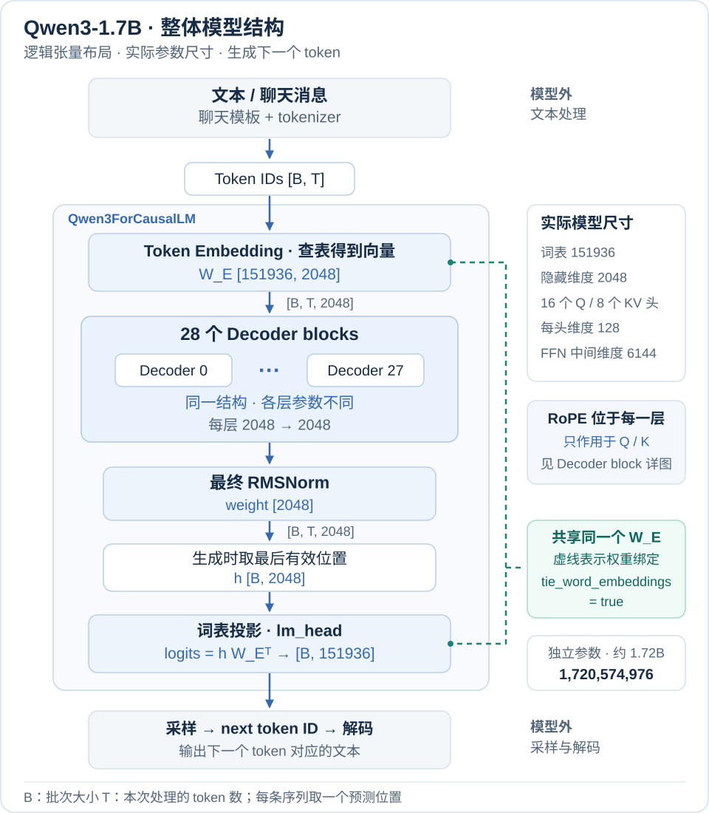
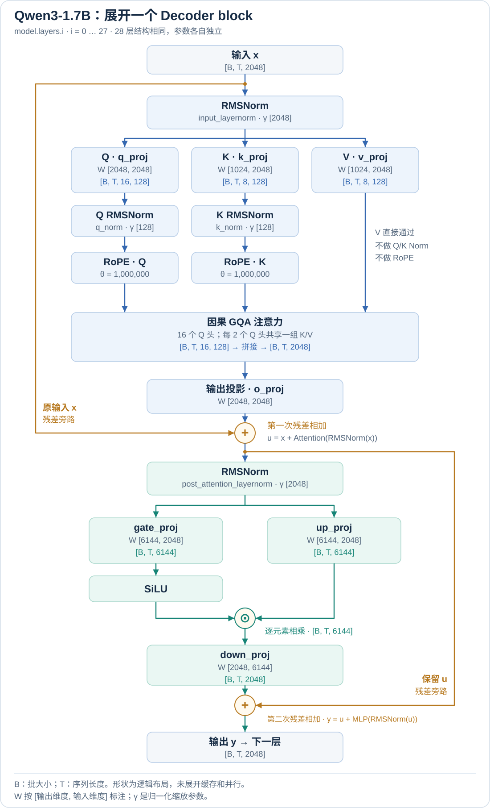
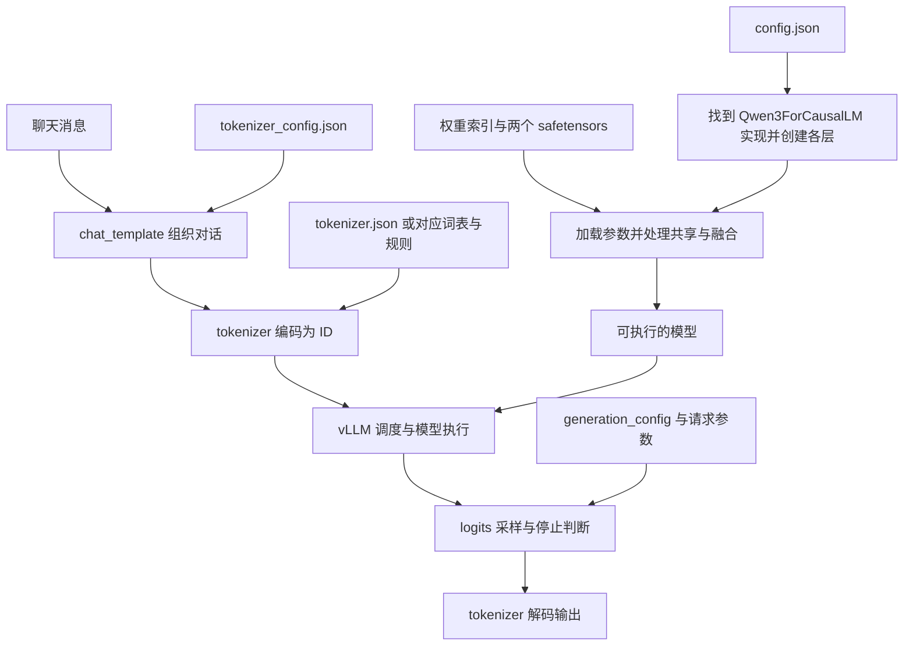

# 读懂 Qwen3-1.7B：模型文件的用途、关系与加载流程

下载好 Qwen3-1.7B 后，目录里既有几个 GB 的权重，也有几百字节的 JSON。理解这些文件，可以先抓住一条线：**配置和权重共同组成模型，tokenizer 和模板把文字变成模型输入，生成配置决定怎样从输出分数中选出下一个 token。**

同一组文件通常共同完成一项工作。例如，索引和权重文件头一起定位参数；词表和合并规则一起定义 BPE 分词；两个配置文件里出现同一个 EOS ID，则是在不同环节引用同一个 token。本文按这些关系分组，先讲分工和拆分原因，再打开文件看实际数据，最后接到模型结构与 vLLM 的加载流程。

文中的具体字段、数量、张量形状和分片信息，来自对 `nanovllm` 主机上 `/root/models/Qwen3-1.7B` 的只读检查。除明确标出的 BPE 教学示例外，JSON 示例均为实际数据的完整展示或明确标注的摘录；不同来源、不同保存版本的同名模型，分片方式不一定相同。

## 1. 先按职责认识这 11 个文件

```text
Qwen3-1.7B/
├── LICENSE
├── README.md
├── config.json
├── generation_config.json
├── merges.txt
├── model-00001-of-00002.safetensors
├── model-00002-of-00002.safetensors
├── model.safetensors.index.json
├── tokenizer.json
├── tokenizer_config.json
└── vocab.json
```

| 文件 | 本机大小，约 | 文件格式 | 主要回答什么问题 |
| --- | --- | --- | --- |
| `config.json` | 726 B | JSON 对象 | 模型是什么结构，各层有多大？ |
| `generation_config.json` | 239 B | JSON 对象 | 生成时默认怎样采样、遇到什么停止？ |
| `model-00001-of-00002.safetensors` | 3.20 GiB | 二进制：JSON 文件头 + 张量数据 | embedding 和各层的参数值是什么？ |
| `model-00002-of-00002.safetensors` | 593.5 MiB | 同上 | 这份发布包额外保存的输出层参数是什么？ |
| `model.safetensors.index.json` | 25.0 KiB | JSON 对象 | 每个参数在哪一个分片？ |
| `vocab.json` | 2.6 MiB | JSON 对象 | 一个内部 token 字符串对应哪个 ID？ |
| `merges.txt` | 1.6 MiB | 按行排列的文本规则 | 小片段按什么顺序合成 token？ |
| `tokenizer.json` | 10.9 MiB | JSON 对象 | 整个分词、编码、解码流程怎样执行？ |
| `tokenizer_config.json` | 9.5 KiB | JSON 对象，包含模板字符串 | 怎样加载 tokenizer，怎样组织聊天消息？ |
| `README.md` | 13.6 KiB | Markdown，开头有 YAML 元数据 | 这个模型是什么，怎样使用？ |
| `LICENSE` | 11.1 KiB | 纯文本 | 模型发布采用什么许可证？ |

这些文件可以按共同完成的工作分成四组：

| 文件组 | 相关文件 | 共同完成的工作 |
| --- | --- | --- |
| 模型结构与参数 | `config.json`、两个权重分片、权重索引 | 确定网络结构，并找到、加载训练后的参数 |
| 文本处理 | `vocab.json`、`merges.txt`、`tokenizer.json`、`tokenizer_config.json` | 组织聊天格式，完成文本与 token ID 的转换 |
| 生成控制 | `generation_config.json` | 提供采样和停止行为的默认设置 |
| 发布说明 | `README.md`、`LICENSE` | 供使用者阅读模型说明与许可条款 |

这种拆分体现了职责、存储方式和加载兼容性的差异。它是这份发布包采用的组织方式，不是所有模型都必须提供恰好 11 个文件。下面分别解释各组怎样配合。

表中的 GiB、MiB、KiB 按 1024 换算。目录中实际还有一个默认 `tree` 不显示的 `.gitattributes`，用于 Git 文件管理，不参与模型前向计算。

## 2. 模型组：配置、权重与索引怎样共同还原网络

这一组要把“模型的结构”与“训练后的数值”接起来：`config.json` 提供创建网络需要的尺寸与选项，模型代码定义计算过程，权重文件保存矩阵数值；分片索引与权重文件头负责定位这些数值。

**配置与权重分开，是因为它们的内容、体量和读取方式不同。** 层数、维度等元数据适合保存成可直接阅读的小 JSON；数十亿个参数适合保存成带类型与形状信息的二进制张量。加载器可以先读配置，确定模型实现和预期尺寸，再读取大文件。两部分仍须配套，分开保存不意味着可以任意修改层数和维度后继续使用原权重。

### 2.1 config.json：网络的结构参数

这是一个普通 JSON 对象，值包括字符串、整数、浮点数、布尔值、数组和 `null`。下面摘取本机配置中的主要字段：

```json
{
  "architectures": ["Qwen3ForCausalLM"],
  "model_type": "qwen3",
  "hidden_size": 2048,
  "intermediate_size": 6144,
  "num_hidden_layers": 28,
  "num_attention_heads": 16,
  "num_key_value_heads": 8,
  "head_dim": 128,
  "hidden_act": "silu",
  "attention_bias": false,
  "vocab_size": 151936,
  "max_position_embeddings": 40960,
  "rope_theta": 1000000,
  "rope_scaling": null,
  "tie_word_embeddings": true,
  "torch_dtype": "bfloat16",
  "bos_token_id": 151643,
  "eos_token_id": 151645,
  "use_cache": true
}
```

| 字段 | 在这份模型中的含义 |
| --- | --- |
| `architectures` | 架构名称列表。加载框架据此寻找 `Qwen3ForCausalLM` 的计算实现 |
| `model_type` | 配置类型，用 `qwen3` 对应的配置类解释参数 |
| `hidden_size` | 每个 token 在主干网络中的隐藏表示有 2048 个分量 |
| `intermediate_size` | MLP 中间投影的维度为 6144 |
| `num_hidden_layers` | 堆叠 28 层 Decoder block |
| `num_attention_heads` | 16 个 Query 头 |
| `num_key_value_heads` | 8 个 Key/Value 头，每组 K/V 由两个 Q 头共享，即 GQA |
| `head_dim` | 每个注意力头的维度为 128 |
| `hidden_act` | MLP 使用 SiLU 激活函数 |
| `attention_bias` | 此模型的注意力线性投影不使用 bias |
| `vocab_size` | 模型侧词表维度，embedding 和输出投影需要覆盖 151936 个位置 |
| `max_position_embeddings` | 配置声明的位置长度参数；实际可用长度还要结合模型说明、引擎配置和显存 |
| `rope_theta`、`rope_scaling` | RoPE 的相关参数；这里未配置额外的缩放方案 |
| `tie_word_embeddings` | 输入 embedding 与输出投影共享权重 |
| `torch_dtype` | 配置声明 BF16；本机权重文件头也确认数据实际保存为 BF16 |
| `bos_token_id`、`eos_token_id` | 开始、结束 token 的配置 ID，是否插入及如何停止还涉及 tokenizer 和生成配置 |
| `use_cache` | 配置中的缓存开关；缓存本身在运行时产生，具体管理由推理框架负责 |

这个型号中，`16 × 128 = 2048`，恰好等于 `hidden_size`。但阅读其他模型时，应优先看显式的 `head_dim`，不要把“隐藏维度除以头数”当成所有架构都成立的规则。

**`config.json` 描述构造网络需要的参数，不保存训练后的矩阵数值，也没有完整定义 `forward()`。** 归一化、注意力、残差连接按什么顺序执行，仍由 Transformers 或 vLLM 中的模型代码决定。官方配置可与本机文件对照：[Qwen3-1.7B config.json](https://huggingface.co/Qwen/Qwen3-1.7B/blob/main/config.json)。

### 2.2 权重分片：保存训练后的数值

权重之所以还会拆成多个分片，是为了便于大文件存储、传输以及按分片读取。使用逐片加载方式时，可以避免在主机内存中同时展开全部分片。拆分不会减少参数总量，也不决定 GPU 数量。

读取两个文件头后，得到以下结果：

| 分片 | 张量数 | 实际内容 |
| --- | --- | --- |
| `model-00001-of-00002.safetensors` | 310 | `model.embed_tokens.weight`、28 层 Decoder 的参数、最终的 `model.norm.weight` |
| `model-00002-of-00002.safetensors` | 1 | `lm_head.weight` |

这里的“310 个张量”与“17 亿参数”是不同的计数。一个张量里可以有数百万个数，每一个数才对应一个参数元素。例如 `model.layers.0.self_attn.q_proj.weight` 就是一个含 `2048 × 2048` 个元素的矩阵。

这些参数名称也描述了层级：`model.layers.0` 是第 0 层，`self_attn` 是注意力模块，`q_proj` 是生成 Query 的投影，`weight` 表示其权重。它保存的是计算 Q 的参数，不是某一次输入产生的 Q。

### 2.3 Safetensors 文件头：描述单个文件中的张量

Safetensors 的结构可以写成：

```text
文件开头
  │
  ├─ 8 字节：小端无符号整数 N，表示 JSON 文件头的长度
  │
  ├─ N 字节：UTF-8 JSON 文件头
  │           参数名 → dtype、shape、data_offsets
  │
  └─ 数据区：张量的原始数值字节
              不以 JSON 数字数组的形式保存
```

第一片的 JSON 文件头长 **35648 字节**。下面是其中两个张量的真实记录，其他条目已省略：

```json
{
  "model.embed_tokens.weight": {
    "dtype": "BF16",
    "shape": [151936, 2048],
    "data_offsets": [0, 622329856]
  },
  "model.layers.0.self_attn.q_proj.weight": {
    "dtype": "BF16",
    "shape": [2048, 2048],
    "data_offsets": [710418944, 718807552]
  }
}
```

| 字段 | 怎样读 |
| --- | --- |
| 参数名 | 这块数值属于哪一个参数 |
| `dtype` | 每个元素的编码类型；`BF16` 是 16 位浮点格式，每个元素占 2 字节 |
| `shape` | 怎样把连续数值解释为张量；`[2048, 2048]` 表示一个二维矩阵 |
| `data_offsets` | 张量在**数据区内**的字节范围，左闭右开，不是相对整个文件的偏移 |

因此，上面 Q 投影的数据占用为：

```text
718807552 - 710418944 = 8388608 字节
2048 × 2048 × 2      = 8388608 字节 = 8 MiB

该张量在整个文件中的起始位置：
8 + 35648 + 710418944 = 710454600
```

只读 JSON 文件头，就能知道有哪些矩阵、各自多大、应当从哪里读取；不需要先把整个 3 GB 文件加载到显存。文件头中的 `__metadata__` 如果出现，保存的是字符串元数据，例如 `{"format":"pt"}`，不计入张量数。格式定义见 [Safetensors 规范](https://github.com/safetensors/safetensors#format)。

真正的数值在后面的二进制区。本机 Q 投影的前 8 个 BF16 元素解码后是：

```text
[-0.008056640625, -0.006866455078125, -0.006805419921875,
 -0.00677490234375, 0.010498046875, -0.0194091796875,
 -0.01611328125, 0.00335693359375]
```

这些才是训练得到的参数值。文件里没有把上面这一行当作文本保存；这是读取原始字节并解码后的展示。

### 2.4 权重索引：把参数定位到分片

索引把多个分片组织成一套可查找的权重。它是一个 JSON 对象。下面保留了本机 `metadata` 和部分 `weight_map` 条目：

```json
{
  "metadata": {
    "total_size": 4063479808
  },
  "weight_map": {
    "lm_head.weight": "model-00002-of-00002.safetensors",
    "model.embed_tokens.weight": "model-00001-of-00002.safetensors",
    "model.layers.0.self_attn.q_proj.weight": "model-00001-of-00002.safetensors",
    "model.layers.0.self_attn.k_proj.weight": "model-00001-of-00002.safetensors",
    "model.layers.0.self_attn.v_proj.weight": "model-00001-of-00002.safetensors"
  }
}
```

`weight_map` 的键是参数名，值是分片文件名。它告诉加载器“去哪个文件找”，而 Safetensors 文件头里的 `data_offsets` 进一步说明“在这个文件的数据区哪里找”。

`metadata.total_size` 在本机等于张量数据的总字节数，不包含文件头。两个实际文件总大小为 4063515592 字节，多出的 35784 字节正好是两份长度字段和文件头：`8 + 35648 + 8 + 120`。

这就形成了两层定位：**参数名 → 分片文件名 → 数据区中的字节范围**。索引负责跨文件查找，文件头负责文件内部查找，二者各自保存所需的元数据。只有一个权重文件时，通常不需要额外的跨文件索引。

这个索引不保存矩阵数值，也不定义 GPU 分配。**两个分片不等于需要两张 GPU。** 引擎可以把两个文件加载到一张显存足够的卡，也可以把某个矩阵按并行规则切给多张卡。分片与索引的通用约定见 [Hugging Face 分片检查点说明](https://huggingface.co/docs/transformers/main/en/big_models#sharded-checkpoints)。

### 2.5 用实际张量形状核对配置

配置、权重和模型代码是否匹配，可以先用形状交叉核对。以下形状来自本机文件头。线性层权重采用 `[输出维度, 输入维度]` 的约定：

| 参数 | 实际形状 | 和配置的对应关系 |
| --- | --- | --- |
| `model.embed_tokens.weight` | `[151936, 2048]` | `vocab_size × hidden_size` |
| `model.layers.0.self_attn.q_proj.weight` | `[2048, 2048]` | 输出 `16 × 128` 维 Query |
| `model.layers.0.self_attn.k_proj.weight` | `[1024, 2048]` | 输出 `8 × 128` 维 Key |
| `model.layers.0.self_attn.v_proj.weight` | `[1024, 2048]` | 输出 `8 × 128` 维 Value |
| `model.layers.0.self_attn.o_proj.weight` | `[2048, 2048]` | 把注意力结果投影回隐藏维度 |
| `model.layers.0.self_attn.q_norm.weight` | `[128]` | Q 的逐头归一化参数 |
| `model.layers.0.self_attn.k_norm.weight` | `[128]` | K 的逐头归一化参数 |
| `model.layers.0.mlp.gate_proj.weight` | `[6144, 2048]` | MLP 的 gate 投影 |
| `model.layers.0.mlp.up_proj.weight` | `[6144, 2048]` | MLP 的 up 投影 |
| `model.layers.0.mlp.down_proj.weight` | `[2048, 6144]` | 从 MLP 中间维度投影回隐藏维度 |
| `lm_head.weight` | `[151936, 2048]` | 把隐藏表示变成各词表位置的输出分数 |

Qwen3 的 Q/K 归一化发生在每个头的 128 维表示上，所以这里看到的是 `[128]`，不是 `[2048]`。模型中的归一化与投影执行顺序可以对照 [vLLM 的 Qwen3 实现](https://github.com/vllm-project/vllm/blob/main/vllm/model_executor/models/qwen3.py)。

### 2.6 共享权重与磁盘大小：为什么 1.7B 接近 4 GB

第二片的文件头长 120 字节，完整 JSON 内容如下，排版后的空白与文件内不完全相同：

```json
{
  "__metadata__": {"format": "pt"},
  "lm_head.weight": {
    "dtype": "BF16",
    "shape": [151936, 2048],
    "data_offsets": [0, 622329856]
  }
}
```

它单独保存了输出层的 `151936 × 2048` 个元素，共 **622329856 字节**，约 593.5 MiB。

但配置里明明写着 `tie_word_embeddings: true`。为确认这份文件的情况，我们对 `model.embed_tokens.weight` 与 `lm_head.weight` 各自的数据区做了流式 SHA-256 校验，结果一致：**这份发布包把共享权重又保存了一份。**

两个分片共存储 2031739904 个 BF16 元素；扣掉这份重复的 311164928 个元素，剩下 1720574976 个，约 **1.72B**。因此，磁盘中张量元素的总数不一定等于模型独立参数的数量；磁盘大小也不等于引擎最终的显存占用。

本节从磁盘元素总数扣除共享副本，得到约 1.72B 个独立参数；第 5 节再按网络组件求和，对同一结果进行交叉核对。

这个结论针对本机这份文件。其他保存方式可以只保留一份共享权重，由加载代码恢复绑定关系，不能据此要求所有 Qwen3-1.7B 都必须单独提供 `lm_head.weight`。共享张量的保存问题见 [Safetensors 与 PyTorch 共享张量](https://huggingface.co/docs/safetensors/en/torch_shared_tensors)。

## 3. 文本组：四个 tokenizer 文件为什么同时存在

模型接收 token ID，但使用者输入文字或聊天消息。这四个文件共同描述从消息到 ID、再从输出 ID 回到文字的过程。它们之间既有职责分工，也有为不同加载方式保留的重复内容。

### 3.1 先理解 BPE：怎样从小片段学出 token

**BPE 是 Byte Pair Encoding，通常译为“字节对编码”。** 用于分词时，它从小符号开始，逐步把经常相邻出现的一对符号合成更大的 token。例如，`a` 和 `n` 可以合成 `an`，之后 `b` 和 `an` 又可以合成 `ban`。这里的“一对”是两个当前符号，合并到后面时，每个符号本身可能已经包含多个字符或字节。

为什么这样做？如果把每个完整单词都收入词表，词表会很大，还难以覆盖新词；如果始终逐字符或逐字节编码，序列又可能很长。BPE 让常见片段拥有自己的编号，同时保留较小的片段来组合其他文本。因此，**token 可以是完整单词、单词的一部分，也可以是其他字节片段，不等于自然语言中的“词”。** BPE 的基本训练与编码过程见 [Hugging Face BPE 教程](https://huggingface.co/learn/llm-course/en/chapter6/5)。

**先看训练：从语料中学习词表和合并规则。** 下面是自拟的教学例子，按字符起步，假设每个单词已经是一个独立的预切分片段；其中的规则和 ID 都不是 Qwen 的实际数据。

| 训练文本 | 出现次数 | 初始符号序列 |
| --- | ---: | --- |
| `banana` | 3 | `[b, a, n, a, n, a]` |
| `band` | 2 | `[b, a, n, d]` |
| `ban` | 1 | `[b, a, n]` |

初始词表只有 `a、b、d、n`。统计所有片段内部的相邻符号对，并按文本出现次数加权：`a + n` 在每个 `banana` 中出现两次，所以它的总次数是 `2 × 3 + 1 × 2 + 1 × 1 = 9`，是第一轮最常见的一对。

| 轮次 | 本轮最常见的相邻对 | 加权次数 | 合并后 `banana` 的表示 |
| --- | --- | ---: | --- |
| 1 | `a + n → an` | 9 | `[b, an, an, a]` |
| 2 | `b + an → ban` | 6 | `[ban, an, a]` |

每轮都用新符号替换语料中的对应相邻对，再重新统计当前的相邻对。第二轮时，三种文本都以 `b, an` 开头，所以这对的次数为 `3 + 2 + 1 = 6`。旧 token 会保留在词表中，新 token 继续加入；实际训练会按目标词表大小等条件停止，这里为了演示只做两轮。

这次训练会得到两份相互配合的数据。假设给 token 分配下面这些教学用 ID，词表可以写成：

```json
{"a": 0, "b": 1, "d": 2, "n": 3, "an": 4, "ban": 5}
```

合并规则则按学习顺序保存，每行两个符号：

```text
a n
b an
```

这就对应了 **`vocab.json` 保存编号，`merges.txt` 保存合并规则及其优先级**。前者告诉我们 `ban` 的 ID 是什么，后者说明怎样从初始符号得到它。

**再看编码：对新输入应用已经固定的规则。** 使用上面的教学 tokenizer 编码 `band`：

```text
输入文本：       band
初始符号：       [b, a, n, d]
应用 a + n：     [b, an, d]
应用 b + an：    [ban, d]
查询词表得到 ID：[5, 2]
```

实际编码时，在当前可合并的相邻对中，优先使用排名靠前的规则，直到没有可用规则。它不会重新统计这次输入的词频，也不会临时给 `band` 新增一个 token；它也不等于从词表中贪心地找最长字符串。这里所说的“训练 tokenizer”是准备分词数据，与训练 Transformer 的权重是两个不同过程。

**回到 Qwen：它使用 ByteLevel BPE。** 上面的字符例子便于手算；Qwen 对普通文本做规范化和正则预切分后，将片段的 UTF-8 字节映射成内部符号，再进行 BPE 合并。例如，“你”的 UTF-8 编码是三个字节 `E4 BD A0`，所以不能假定一个汉字天然就是一个 token。最终边界取决于已学到的规则，可能落在字符内部，也可能包含多个字符。ByteLevel 用 256 个内部符号对应全部字节值，见 [Tokenizers 的 ByteLevel 说明](https://huggingface.co/docs/tokenizers/en/components#pre-tokenizers)。

对本机文件逐条核对后，151387 条规则的合并结果互不重复，全部存在于基础词表；去掉这些结果，恰好剩下 256 个初始符号：

**256 个初始字节符号 + 151387 个合并结果 = 151643 个基础 token。**

这解释了本例中词表大小与合并规则数量的关系。后面介绍的 26 个追加 token 另行登记，不包含在这个基础 BPE 词表里。

### 3.2 先看关系：独立 BPE 数据、整合后端与上层配置

先把四个文件的位置放在一起看。下面表示内容对应关系，不表示引擎每次必须依次读取四个文件：

```text
tokenizer.json
├── model
│   ├── type: BPE
│   ├── vocab ───────── 与 vocab.json 内容相同：151643 个基础 token
│   └── merges ──────── 与 merges.txt 去掉版本头后的有序规则对应
├── added_tokens ────── 26 个追加 token，包含两个默认用作 EOS 的 token
├── normalizer ──────── 文本规范化
├── pre_tokenizer ───── 预切分与字节映射
├── post_processor ──── 编码后的处理
└── decoder ─────────── 将内部 token 表示还原成文本

tokenizer_config.json
├── tokenizer_class、eos_token、pad_token 等上层加载设置
├── added_tokens_decoder：追加 token 的 ID 到描述的映射
└── chat_template：聊天消息的格式化模板
```

| 为什么分开或重复保存 | 具体关系 |
| --- | --- |
| 词表与规则分工不同 | `vocab.json` 保存 token 到 ID 的映射；`merges.txt` 保存有顺序的 BPE 合并规则 |
| 兼容不同加载方式 | `tokenizer.json` 把词表、规则和处理组件整合成后端可读取的序列化文件；独立词表和规则文件可供相应的其他 tokenizer 实现与加载路径使用 |
| 分词后端与上层使用配置不同 | `tokenizer.json` 描述编码、解码流程；`tokenizer_config.json` 帮助上层库选择 tokenizer 类、设置 token 角色，并在本例中提供聊天模板 |

初始化时，加载器从适用的文件恢复一套 tokenizer。Fast tokenizer 可以从整合 JSON 恢复处理流程；其他路径可以用独立词表、规则和对应实现恢复流程。具体读取哪些文件由加载器决定。请求到来后，通常复用内存中的对象，按需完成模板格式化、编码和解码，不逐次重新读取这些文件。

**这些边界不是完全没有重叠。** 本机 `tokenizer.json.model.vocab` 与 `vocab.json` 内容完全一致，`model.merges` 与 `merges.txt` 的规则顺序逐条一致；追加 token 也同时出现在 `added_tokens` 和 `added_tokens_decoder` 中。重复保存的描述应当一致，不能把这些文件当成可以随意替换的独立组件。

### 3.3 vocab.json：基础 token 的编号表

这是一个 JSON 对象，结构是 **`内部 token 字符串 → 整数 ID`**。下面是本机的实际条目摘录：

```json
{
  "!": 0,
  "\"": 1,
  "#": 2,
  "a": 64,
  "b": 65,
  "Ċ": 198,
  "Ġ": 220,
  "hello": 14990,
  "Ġhello": 23811
}
```

它相当于编号表。比如内部 token `hello` 的 ID 是 14990，模型可以用它选择 embedding 的第 14990 行。这个 ID 不是概率、词频或字符串长度。

这里的 `Ġ` 和 `Ċ` 容易被当成乱码。Qwen 采用 ByteLevel BPE，把字节映射成内部字符表示：`Ġ` 对应空格字节，`Ċ` 对应换行字节。所以 `hello` 与 `Ġhello` 是两个不同 token，后者带有前导空格的含义。中文的 UTF-8 字节也会经过这种映射，不一定直接以原来的汉字出现在词表键中。相关机制见 [ByteLevel 组件说明](https://huggingface.co/docs/tokenizers/en/components#pre-tokenizers)。

本机基础词表有 **151643 个条目**，ID 连续分布在 **0～151642**。后面介绍 `tokenizer.json` 时，再把追加 token 与模型的词表维度放在一起比较。

### 3.4 merges.txt：怎样合成这些 token

这是纯文本，开头是格式版本，后面每行是一对可合并的内部符号。本机前几行如下：

```text
#version: 0.2
Ġ Ġ
ĠĠ ĠĠ
i n
Ġ t
ĠĠĠĠ ĠĠĠĠ
e r
ĠĠ Ġ
o n
```

例如，`i n` 表示相邻的 `i` 和 `n` 可以合并成 `in`；`Ġ t` 表示空格对应的符号可以与 `t` 合成 `Ġt`。一行中间的普通空格是两列的分隔符，显示为 `Ġ` 的才是 token 内部的空格字节表示。

**规则在文件里的顺序代表优先级，越靠前，合并优先级越高。** 这就是前面教学示例中先使用 `a n`、再使用 `b an` 的依据，通常称为合并排名（merge rank）。BPE 在预切分得到的片段内工作，不能任意跨越片段边界。

本机文件有 151388 行，其中一行是版本头，剩下 **151387 条合并规则**。`vocab.json` 回答“合并出来的 token 编号是什么”，`merges.txt` 回答“如何进行合并”。

### 3.5 tokenizer.json：完整分词流程与追加 token

`vocab.json` 和 `merges.txt` 主要描述 BPE 的数据；`tokenizer.json` 还把前处理、后处理和解码组件放在一起。它可以被 fast tokenizer 后端读取。

下面展示本机文件的结构摘录。`added_tokens`、`model.vocab` 和 `model.merges` 只保留少量实际成员，其他顶层组件在后面的表格中解释；这段不能替代完整文件：

```json
{
  "version": "1.0",
  "truncation": null,
  "padding": null,
  "added_tokens": [
    {
      "id": 151644,
      "content": "<|im_start|>",
      "single_word": false,
      "lstrip": false,
      "rstrip": false,
      "normalized": false,
      "special": true
    }
  ],
  "normalizer": {"type": "NFC"},
  "decoder": {
    "type": "ByteLevel",
    "add_prefix_space": false,
    "trim_offsets": false,
    "use_regex": false
  },
  "model": {
    "type": "BPE",
    "unk_token": null,
    "byte_fallback": false,
    "vocab": {"!": 0, "hello": 14990},
    "merges": [["Ġ", "Ġ"], ["ĠĠ", "ĠĠ"], ["i", "n"]]
  }
}
```

| 顶层字段 | 本机的内容与作用 |
| --- | --- |
| `version` | tokenizer 序列化格式版本 `1.0`，不是 Qwen 模型代数 |
| `truncation`、`padding` | 文件中都是 `null`，表示这里没有固化对应配置；调用时仍可另行指定 |
| `added_tokens` | 26 个追加 token 的描述数组，包括 ID、字符串和匹配属性 |
| `normalizer` | `NFC`，对 Unicode 文本进行规范化 |
| `pre_tokenizer` | `Sequence`，先按 `Split` 中的正则划分文本，再做 `ByteLevel` 字节映射 |
| `model` | `BPE`，内含完整基础词表、有顺序的合并规则和其他分词选项 |
| `post_processor` | `ByteLevel`，处理编码结果相关信息；本机 `trim_offsets` 为 `false` |
| `decoder` | `ByteLevel`，把内部 token 表示还原为字节和文本 |

`added_tokens` 中，`lstrip`、`rstrip` 决定匹配时是否一并吸收左右空白；`single_word` 影响词边界匹配，`normalized` 决定是否按规范化后的文本匹配，`special` 表示是否按特殊 token 处理。**追加 token 不一定都标记为 special**：本机 `<think>` 和 `</think>` 的 ID 分别为 151667、151668，二者的 `special` 都是 `false`。

在这份序列化文件里，`model.merges` 使用二维数组；独立 `merges.txt` 则用一行两个符号表达同一条规则。

把这套 token 映射与模型矩阵对起来，三个数字分别是：

| 层次 | 本机数量 | 含义 |
| --- | ---: | --- |
| 基础 BPE 词表 | 151643 | `vocab.json` / `model.vocab` 中的条目 |
| 完整 tokenizer 映射 | 151669 | 基础词表加 26 个 added tokens，最大 ID 为 151668 |
| 模型侧词表维度 | 151936 | `config.json.vocab_size`，也是 embedding / lm_head 的行数 |

模型矩阵比已映射的 token 多 267 行。因此，文件中 token 的数量、最大 ID、模型矩阵的行数是不同概念，不能要求它们都相等。两个 EOS ID 的存放位置会在第 4 节与生成配置一起说明。

对普通文本片段，流程可以理解为 **NFC 规范化 → 正则预切分 → ByteLevel 映射 → BPE 合并 → token ID**；追加 token 还会按其匹配属性单独识别。`byte_fallback: false` 是 BPE 的一个选项，不等于没有使用 ByteLevel。各组件的分工见 [Tokenizers 处理流程](https://huggingface.co/docs/tokenizers/en/pipeline)。

### 3.6 tokenizer_config.json：上层加载选项与 token 角色

这个文件侧重 Transformers 等上层代码怎样使用分词后端。它同样是 JSON，适合保存加载选项、特殊 token 角色和模板等元数据。本机部分内容如下，`added_tokens_decoder` 仅保留两个条目，聊天模板稍后单独展示：

```json
{
  "tokenizer_class": "Qwen2Tokenizer",
  "add_bos_token": false,
  "add_prefix_space": false,
  "bos_token": null,
  "eos_token": "<|im_end|>",
  "pad_token": "<|endoftext|>",
  "model_max_length": 131072,
  "clean_up_tokenization_spaces": false,
  "added_tokens_decoder": {
    "151644": {
      "content": "<|im_start|>",
      "lstrip": false,
      "normalized": false,
      "rstrip": false,
      "single_word": false,
      "special": true
    },
    "151645": {
      "content": "<|im_end|>",
      "lstrip": false,
      "normalized": false,
      "rstrip": false,
      "single_word": false,
      "special": true
    }
  }
}
```

注意这里的几个对应关系：

- 模型架构叫 `Qwen3ForCausalLM`，tokenizer 类却写 `Qwen2Tokenizer`。这是复用分词实现，不能只看这个名字就认为模型版本错了；实际加载器也可能选择相应的 fast 实现。
- `added_tokens_decoder` 是以 ID 的字符串形式为键的对象，因为 JSON 对象的键必须是字符串；而 `tokenizer.json` 的 `added_tokens` 是带 `id` 字段的数组。
- `<|im_start|>` 表示一条消息开始，`<|im_end|>` 表示消息结束，`<|endoftext|>` 在这里也被用作 PAD。它们的 token ID 分别是 151644、151645、151643。
- `add_bos_token: false` 和 `bos_token: null` 说明不能因为模型配置有 `bos_token_id`，就认定每段输入前都会自动插入 BOS。
- `model_max_length: 131072` 是 tokenizer 的长度元数据。它既不等于配置中的 `max_position_embeddings: 40960`，也不能证明部署服务已经支持 131072 上下文；本机 README 标注的上下文长度是 32768。

这套 tokenizer 还保留了若干带 `vision`、`image` 名称的 token。**词表里有这些字符串，不代表这个纯文本 Qwen3-1.7B 就具备视觉编码器或图片理解能力。** 能力还取决于模型结构和训练。

### 3.7 chat_template：把消息列表接到分词流程

这个目录没有单独的 `chat_template.jinja`，模板保存在 `tokenizer_config.json` 的 `chat_template` 字段中。JSON 里它是一个带 `\n` 等转义字符的长字符串；解析 JSON 后，可以按多行 Jinja 模板阅读。

下面是本机模板末尾的实际逻辑，负责生成 assistant 开头，并处理关闭 thinking 的情况：

```jinja

    {{- '<|im_start|>assistant\n' }}
    
        {{- '<think>\n\n</think>\n\n' }}
    

```

完整模板还负责遍历消息、处理角色、历史推理内容和工具调用。对于下面这条消息：

```json
[{"role": "user", "content": "你好"}]
```

用实际模板设置 `add_generation_prompt=true`，不额外关闭 thinking，渲染结果是：

```text
<|im_start|>user
你好<|im_end|>
<|im_start|>assistant
```

如果再设置 `enable_thinking=false`，末尾会多出一段空的思考区间：

```text
<|im_start|>user
你好<|im_end|>
<|im_start|>assistant
<think>

</think>

```

这两段输出来自本机 Jinja2 对实际模板的渲染验证，没有调用模型生成。模板只负责把消息排成特定格式，不能把渲染结果当成模型已经给出的回答。

这也说明模板为什么与 BPE 数据分开：词表和合并规则处理文本片段，模板处理消息角色、工具调用等对话结构。它们可以由不同层的代码负责，但模板仍须符合模型训练时采用的格式。

**聊天模板把消息列表变成待续写的文本，tokenizer 再把文本变成 ID。** 模型读取的是后者。模板保存方式和使用方法见 [Hugging Face 聊天模板文档](https://huggingface.co/docs/transformers/en/chat_templating)，本机内容可与 [Qwen3 tokenizer 配置](https://huggingface.co/Qwen/Qwen3-1.7B/blob/main/tokenizer_config.json)对照。

## 4. 生成组：采样与停止为什么另放一个配置文件

前面的文件决定输入怎样编码、网络怎样计算。`generation_config.json` 接着描述：拿到 logits 以后，默认怎样选择 token、怎样结束生成。

**生成设置单独保存，是为了把输出策略与网络结构、训练权重分开管理。** 调整温度或采样范围不需要重写数 GB 的权重，也不需要重新定义 BPE。框架或请求可以按其支持方式覆盖默认值；BOS、EOS、PAD 等 ID 则仍要对应这套 tokenizer 的约定。

### 4.1 generation_config.json：输出选择的默认值

这份文件很小，本机完整内容如下：

```json
{
  "bos_token_id": 151643,
  "do_sample": true,
  "eos_token_id": [151645, 151643],
  "pad_token_id": 151643,
  "temperature": 0.6,
  "top_k": 20,
  "top_p": 0.95,
  "transformers_version": "4.51.0"
}
```

模型前向计算产生 logits，即对各个输出 token 的分数。生成过程再根据采样设置选择下一个 token，并检查是否结束。

| 字段 | 含义 |
| --- | --- |
| `do_sample: true` | 默认采用采样方式生成 |
| `temperature: 0.6` | 调整分数对应分布的尖锐程度；温度更低通常更集中 |
| `top_k: 20` | 保留分数最高的 20 个候选参与后续采样 |
| `top_p: 0.95` | 按累计概率筛选候选，采用达到阈值所需的高概率部分 |
| `eos_token_id` | 这里是数组，列出两个可作为结束条件的 token ID |
| `pad_token_id` | 填充 token 的 ID；填充与结束的语义不同，即使复用了同一个 ID |
| `transformers_version` | 保存配置时记录的 Transformers 版本，不是服务运行时的版本检测结果 |

字段定义见 [GenerationConfig 文档](https://huggingface.co/docs/transformers/en/main_classes/text_generation)。

vLLM 默认可以读取模型目录的生成配置；`--generation-config vllm` 则使用 vLLM 自己的默认值，再结合请求设置。参见 [vLLM 生成配置参数](https://docs.vllm.ai/en/stable/configuration/engine_args/#--generation-config)。

### 4.2 沿 EOS ID 串起生成配置与 tokenizer

前面的基础词表只覆盖 ID 0～151642，所以执行 `grep 151645 vocab.json` 或 `grep 151643 vocab.json` 没有结果。这里要同时看 token 映射与生成配置。

这两个结束标记属于 **added tokens**，位置如下：

| ID | token 字符串 | `vocab.json` / `model.vocab` | `tokenizer.json.added_tokens` |
| --- | --- | --- | --- |
| 151643 | `<\|endoftext\|>` | 不包含 | 包含，`special: true` |
| 151645 | `<\|im_end\|>` | 不包含 | 包含，`special: true` |

在 `tokenizer_config.json` 的 `added_tokens_decoder` 中，也能用字符串键 `"151643"`、`"151645"` 找到对应记录。完整 tokenizer 会把基础词表与追加 token 一起纳入 ID 映射，因此这些 token 可以正常编码、解码，也有对应的模型输出位置。

本例的 `generation_config.json` 默认将这两个 ID 用作 EOS。生成阶段新输出的 token 命中其中任意一个，即可满足 EOS 停止条件，不要求连续生成两个。

输入消息中已有的结束标记用于划分消息，不会仅因出现在提示词中就触发这次生成的 EOS 停止判断。`special: true` 本身也不等于“生成后必须停止”；停止行为取决于引擎最终生效的 EOS 设置。这样就把 **token 的定义和存放位置**与**生成阶段怎样使用它**区分开了。

在模型目录运行下面的标准库脚本，就能查到这两个 ID：

```python
import json
from pathlib import Path

tokenizer = json.loads(Path("tokenizer.json").read_text())
for token in tokenizer["added_tokens"]:
    if token["id"] in (151643, 151645):
        print(token["id"], token["content"])
```

输出为：

```text
151643 <|endoftext|>
151645 <|im_end|>
```

同一个 ID 出现在几个配置文件里，是因为这些文件在不同层次引用它：

| 出现的位置 | 这里声明什么 |
| --- | --- |
| `tokenizer.json.added_tokens` | ID 对应哪段 token 字符串，以及怎样匹配它 |
| `tokenizer_config.json` | tokenizer 把哪个字符串当作 EOS、PAD 等角色 |
| `config.json` | 模型配置所记录的 BOS、EOS 等 ID |
| `generation_config.json` | 默认生成时采用哪些结束 ID，以及怎样采样 |

本机 `config.json.eos_token_id` 是 151645，而生成配置接受 151645 和 151643 两个 ID。它们分别是模型配置与生成默认值的表达；实际使用时以引擎最终生效的设置为准。不能像调整温度一样随意替换 token ID，因为它引用的是既有的词表与模型输出位置。

## 5. 把配置与权重画成真实模型结构

现在已经知道配置给出结构参数、文件头给出实际矩阵尺寸，可以把两者接成计算图。图中的“层”与磁盘分片不同：前者描述网络计算，后者描述参数如何存放。

### 5.1 整体结构：从 token ID 到下一个 token

图中的尺寸来自本机配置和权重文件头，计算顺序已与 [Qwen3 的模型实现](https://github.com/huggingface/transformers/blob/main/src/transformers/models/qwen3/modeling_qwen3.py)核对。`B` 表示批大小，`T` 表示本次处理的 token 数；这里画的是便于理解的逻辑形状，vLLM 在运行时可能把多个请求的 token 打平组织。



沿主线读：token ID 查 embedding 得到 2048 维向量，依次经过 28 个 Decoder block，再经过最终 RMSNorm。生成下一个 token 时，每条序列取最后有效位置的隐藏表示 `h`，计算 `h × W_Eᵀ`，得到 151936 个词表位置的分数。

图中的青色虚线表示**输入、输出共享参数，不表示数据绕过中间的 28 层**。输入端用 `W_E` 查表，输出端用同一个矩阵的转置做投影。若计算所有位置的输出，logits 的逻辑形状是 `[B, T, 151936]`；图中展示的是生成时每条序列取一个预测位置的情况。

### 5.2 展开一个 Decoder block

28 个 block 的结构相同，但各自拥有独立参数。下图展开第 `i` 层，权重名称的共同前缀是 `model.layers.i`。蓝色表示注意力部分，绿色表示门控 MLP，橙色表示两条残差旁路。



这层有两个子层，每个子层都先归一化、再计算，最后加回旁路输入，因此是 **Pre-RMSNorm**。`post_attention_layernorm` 虽然名字里有 `post_attention`，但它放在 MLP 之前。把图中的两次残差相加写成式子就是：

$$
u = x + \operatorname{Attention}(\operatorname{RMSNorm}(x)),\qquad
y = u + \operatorname{MLP}(\operatorname{RMSNorm}(u))
$$

注意力部分先投影出 Q/K/V，再对 Q 和 K 的每个 128 维头分别做 RMSNorm，随后对 Q/K 应用 RoPE。V 直接进入注意力计算。16 个 Q 头共享 8 组 K/V，每两个 Q 头使用一组 K/V，这就是本模型的 GQA。因果遮罩限制每个位置只读取自己和之前的位置。

MLP 是 SwiGLU：同一份输入分别进入 `gate_proj` 和 `up_proj`，都扩展到 6144 维；gate 分支经过 SiLU 后，与 up 分支逐元素相乘，再由 `down_proj` 投影回 2048 维。图中的 `⊙` 是逐元素乘法，`+` 是残差加法。

图中没有展开 KV Cache。使用缓存时，每层保存经过归一化与 RoPE 后的 K，以及对应的 V；缓存保留 8 个 K/V 头，Q 不需要存入 KV Cache。这里的缓存是运行时数据，不属于权重文件中的可训练参数。

### 5.3 按结构核对独立参数量

将文件头中的矩阵形状逐项相乘，再按共享关系计数，可以得到：

| 组成 | 计算方式 | 独立参数数量 |
| --- | --- | ---: |
| 共享 embedding / lm_head | `151936 × 2048`，共享部分只计一次 | 311164928 |
| 每层 Q/K/V/O 投影 | `2 × 2048 × 2048 + 2 × 1024 × 2048` | 12582912 |
| 每层 Q/K RMSNorm | `128 + 128` | 256 |
| 每层门控 MLP | `3 × 2048 × 6144` | 37748736 |
| 每层两个主干 RMSNorm | `2048 + 2048` | 4096 |
| 28 个 Decoder block | `28 × 50336000` | 1409408000 |
| 最终 RMSNorm | `2048` | 2048 |
| **整个模型** | `311164928 + 1409408000 + 2048` | **1720574976，约 1.72B** |

表中的“每层”各项是 block 的分解，不要再与 28 层小计重复相加。Q/K RMSNorm 的缩放向量在各自的头之间复用，因此各只有 128 个参数。RoPE、因果遮罩、SiLU 和残差相加没有额外的可训练权重；共享输出层也不再增加一份独立参数。

## 6. 文档组：README 与 LICENSE 分别说明什么

`README.md` 是 Markdown 模型卡。开头通常带有 YAML frontmatter，本机摘录如下：

```yaml
library_name: transformers
license: apache-2.0
pipeline_tag: text-generation
base_model:
- Qwen/Qwen3-1.7B-Base
```

这些字段便于模型平台展示和分类：使用哪个库、属于什么任务、基于哪个模型等。后面的 Markdown 正文介绍参数规模、层数、上下文、thinking 模式、运行示例与推荐设置。它不是运行时结构配置，加载器不会把 README 的一句“28 层”当成创建网络的依据。

`LICENSE` 是纯文本，本机文件开头写明：

```text
Apache License
Version 2.0, January 2004
http://www.apache.org/licenses/
```

它提供发布许可条款，不存储参数，也不参与 token 编码。模型卡里的 `license: apache-2.0` 是元数据标记，实际完整条款放在 `LICENSE`。这两份文档可在 [Qwen3-1.7B 官方模型仓库](https://huggingface.co/Qwen/Qwen3-1.7B/tree/main)中查看。

这两份文件与运行配置分开，是因为面向的使用者不同：程序需要可解析的结构字段和数值，人需要模型背景、示例与完整许可文本。README 的许可标记便于平台展示，LICENSE 保留条款正文，两者不是两套不同的模型参数。

## 7. vLLM 怎样装配和使用这些文件

把上面四组文件接起来，就得到下面的装配与请求处理流程。图表示功能上的依赖关系，不承诺某个版本逐个读取文件的具体调用顺序：



在原生支持路径下，vLLM 根据 `architectures: ["Qwen3ForCausalLM"]` 找到自己的 Qwen3 实现，按配置创建计算层，再加载权重。模型目录里没有 `modeling_qwen3.py` 也正常，因为代码可以由安装好的框架提供。相关机制见 [vLLM 与 Hugging Face 集成说明](https://docs.vllm.ai/en/stable/design/huggingface_integration/)。

加载时还会做参数映射。例如，文件里分开的 Q/K/V 权重可以进入融合的 `qkv_proj`。本机三者的输出维度分别为 2048、1024、1024，合起来是 4096；不考虑量化和多卡切分时，融合权重形状为 `[4096, 2048]`。`gate_proj` 和 `up_proj` 也可以进入融合层。`tie_word_embeddings` 则让运行时的输入、输出投影绑定到共享权重。实现可对照 [vLLM Qwen3 源码](https://github.com/vllm-project/vllm/blob/main/vllm/model_executor/models/qwen3.py)。

之后由引擎管理批次、KV Cache 和多卡执行。**Safetensors 能被读取，只解决了获取数值的问题；引擎还必须有正确的模型计算实现。** 当前 vLLM 也可以让兼容模型使用 Transformers modeling backend，不局限于原生模型类；但后端支持、量化与并行能力仍需要分别确认。参见 [vLLM 支持模型说明](https://docs.vllm.ai/en/stable/models/supported_models/)。

如果还想继续追踪这些矩阵怎样参与推理，可以接着看 [Transformer 的计算](/notes/ai-infra/llm/transformer-math/)与 [KV Cache 和 vLLM](/notes/ai-infra/llm/kv-cache-vllm/)。

## 8. 自己检查文件时，按关系交叉验证

在模型目录中，可以直接格式化查看 JSON，或者看文本文件的开头：

```bash
cd /root/models/Qwen3-1.7B
python3 -m json.tool config.json
python3 -m json.tool generation_config.json
head -n 12 merges.txt
```

权重文件不要用 `cat` 查看。下面这段 Python 只读取每个分片的前 8 字节和 JSON 文件头，打印张量数量、数据类型与形状，不读取完整权重数据区，也不依赖 PyTorch 或 GPU：

```python
from pathlib import Path
import json
import struct

model_dir = Path("/root/models/Qwen3-1.7B")

for path in sorted(model_dir.glob("*.safetensors")):
    with path.open("rb") as f:
        raw_length = f.read(8)
        if len(raw_length) != 8:
            raise ValueError(f"Incomplete file: {path.name}")
        header_size = struct.unpack("<Q", raw_length)[0]
        if header_size > 10_000_000 or 8 + header_size > path.stat().st_size:
            raise ValueError(f"Unexpected header length: {path.name}")
        header = json.loads(f.read(header_size))

    tensors = {k: v for k, v in header.items() if k != "__metadata__"}
    print(path.name, "header bytes:", header_size, "tensors:", len(tensors))
    for name, info in list(tensors.items())[:5]:
        print(" ", name, info["dtype"], info["shape"], info["data_offsets"])
```

阅读这些输出时，把三层关系对起来：`config.json` 给出预期结构，索引指出参数在哪个文件，文件头说明实际保存了什么形状和类型。再看词表、合并规则与聊天模板，就能理解一段文字如何变成模型输入，以及参数文件如何被装配成一次推理。
