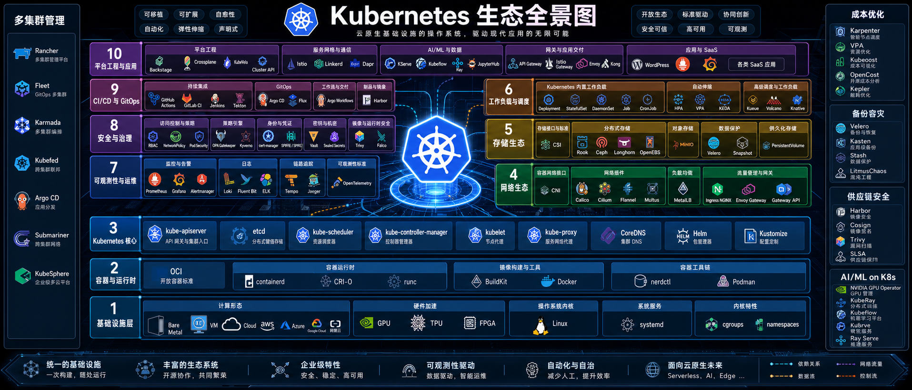

Kubernetes 的基础机制、集群网络、扩展组件和工作负载身份相关笔记。可以按下面的主题开始阅读，也可以从侧边栏浏览完整目录。

- [本地集群：kind](/notes/kubernetes/rwl9lg2c/)
- [Service 原理](/notes/kubernetes/hreo17tb/)
- [容器的本质](/notes/kubernetes/4iyz7vyg/)
- [Calico 架构和使用](/notes/kubernetes/ayl6l9u6/)
- [Karmada 多集群管理](/notes/kubernetes/karmada/)
- [SPIRE 概念与基本原理](/notes/kubernetes/yupcbxxy/)

大部分笔记由 AI 辅助生成，主要用于整理思路、沉淀资料和后续检索，内容可能存在疏漏，使用前建议结合官方文档或实际环境再核对一遍。
